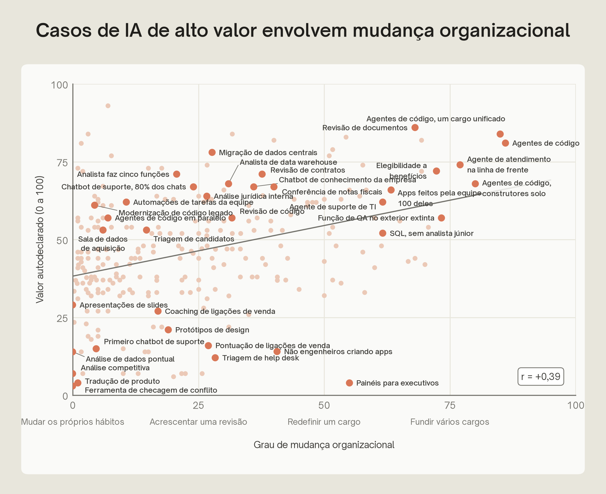
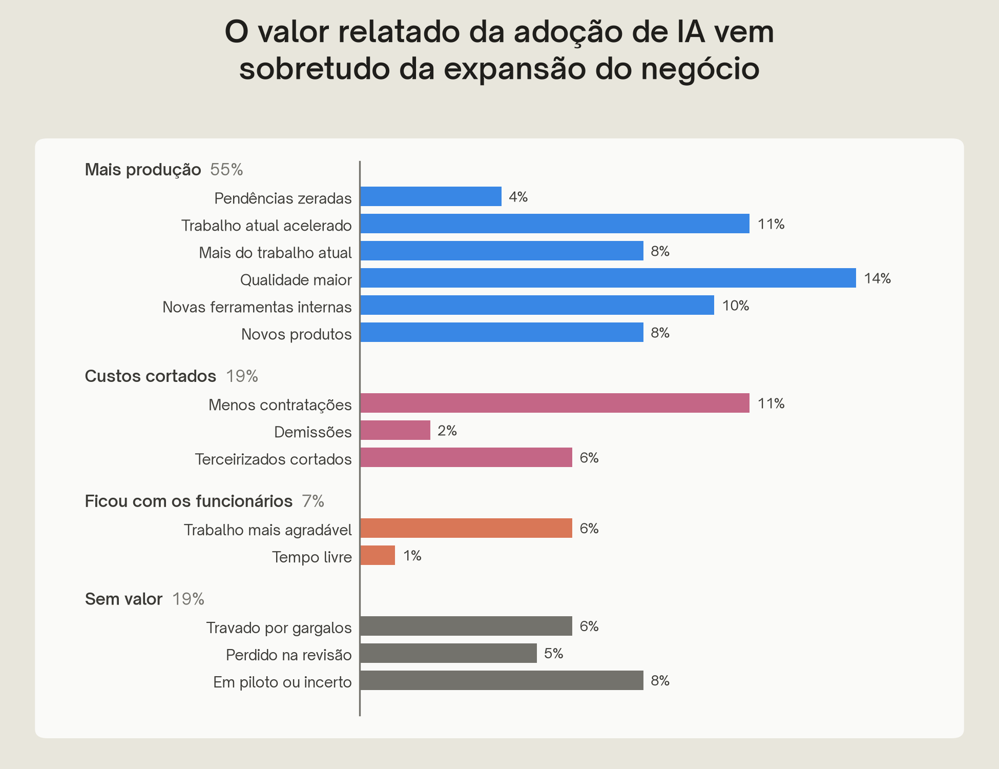
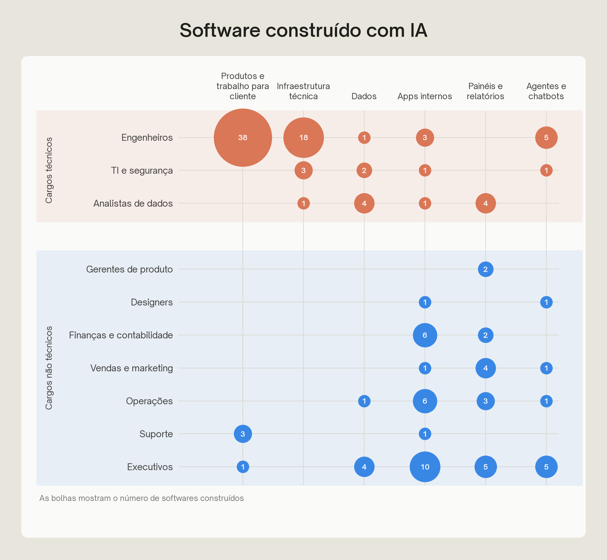
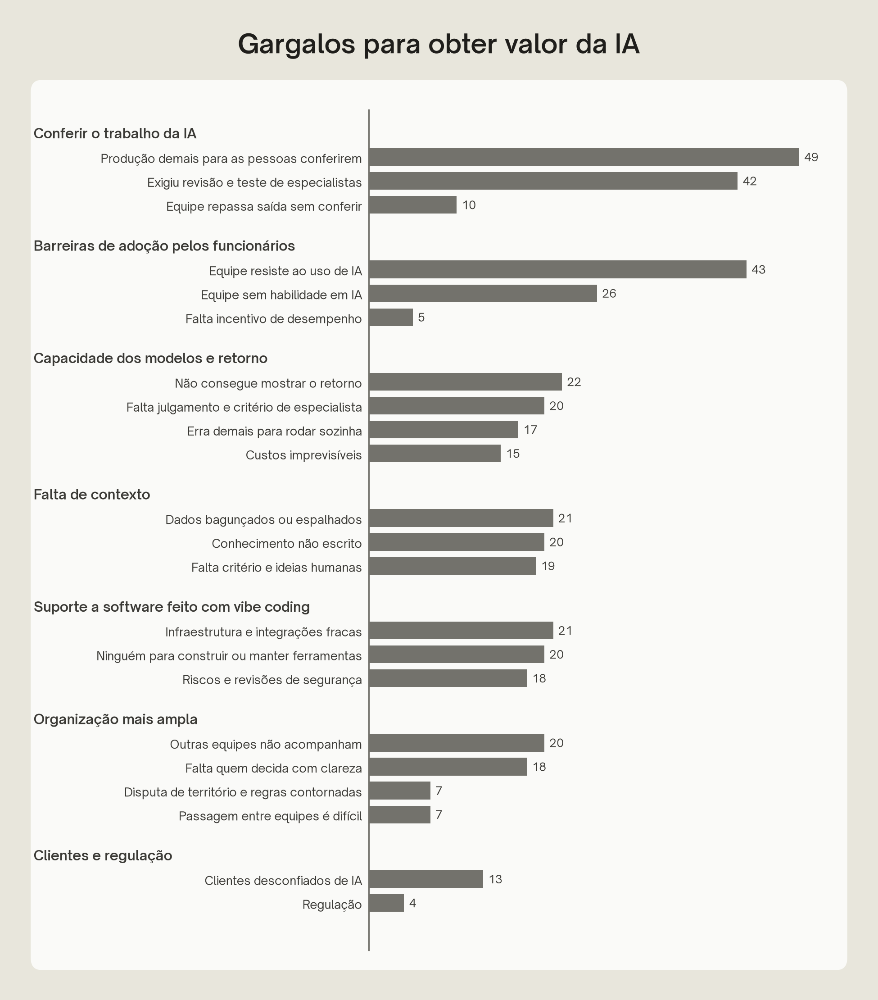
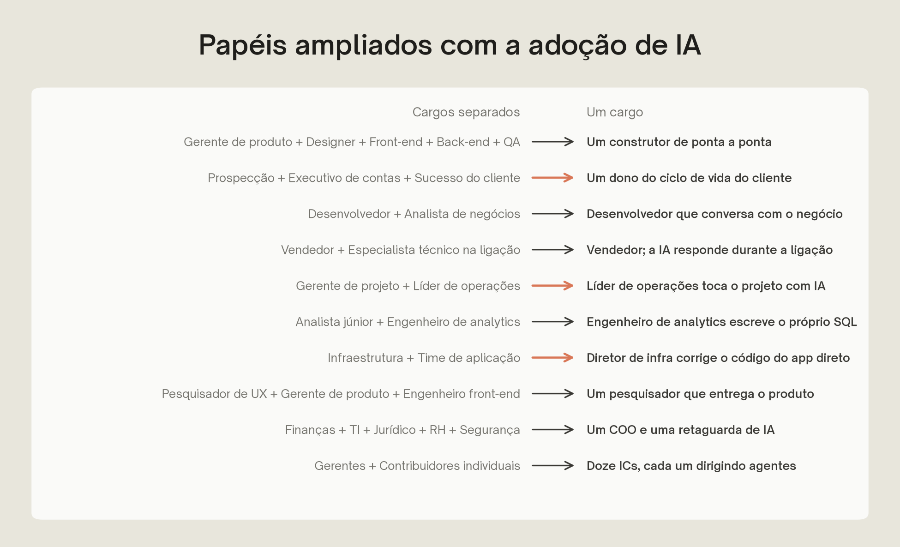
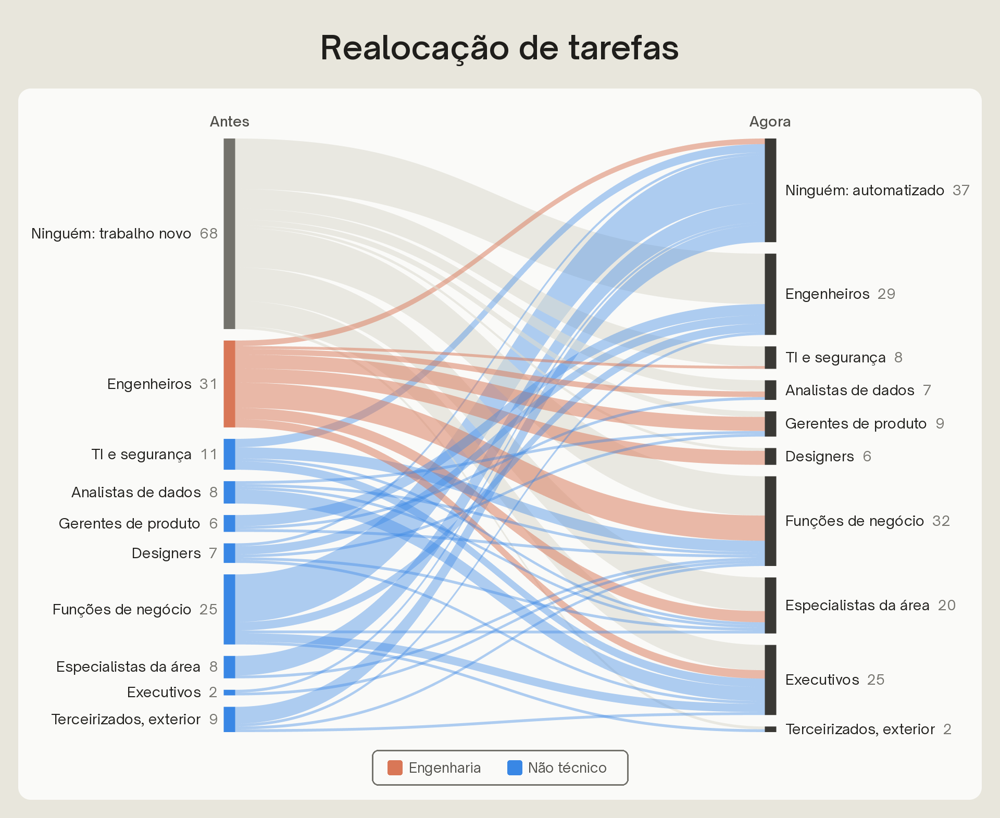

Agradecimentos

Somos gratos aos clientes da Anthropic que dedicaram tempo para conversar abertamente com a gente sobre como estão implementando IA. Pelos comentários e pela ajuda muito úteis, agradecemos a Kia Amiri, Scott Booth, Keir Bradwell, Yena Cho, Brian Clarke, Eleanor Dorfman, Adam Farina, Rebecca Hiscott, Hanah Ho, Tyler Kivley, Caitlin Love, Kerry Persen, Celeste Ridlen, Szymon Sacher, David Saunders, Carolyn Stein, Monika Tuchowska, Scott White, Heather Whitney e Kim Withee. Pela ajuda para viabilizar as entrevistas, agradecemos a Nanita Balagopal, Craig Barry, Alyssa Bonadies, Carolyn Briggs, Travis Bryant, Emily Cole, Tania Ehrsam, Maddie Field, Emily Gray, Bets Hudson, Don Hutchinson, Kelly Kevin, Bill Kolman, Kelly Loftus, Brian Malconian, Katie McNamara, Cope Ono, Camy Pearson, Dartagnan Phan, Naresh Pillay, Meghana Reddy, Conrad Sager, Gurneev Sareen, Lucy Stebbins, Chase Taylor, Michael Taylor, Drew Visconti, Josh Walden e Robby Weitzman.

<h2 id="resumo">Resumo</h2>

Como as empresas, nos vários setores da economia, estão adotando a IA? Que gargalos e desafios elas enfrentaram? Como os empregadores podem reorganizar a expertise humana em torno de modelos cada vez mais capazes? Para entender melhor a experiência das empresas, a gente conduziu 66 entrevistas com 58 clientes corporativos da Anthropic. Encontramos o seguinte:

<ul class="resumo">
<li>
<b>Fontes de valor da IA.</b> As empresas estão aplicando IA numa variedade estonteante de tarefas de trabalho intelectual. Em especial, estão usando cada vez mais agentes de programação para levar capacidade de software a funções não técnicas. Os entrevistados relatam que a maior parte dos usos de IA gera valor aumentando a produção, e não cortando custos. Eles atribuem isso tanto à IA acelerar o trabalho que já existia quanto ao seu papel em introduzir melhorias novas em produtos e serviços.</li>
<li>
<b>Impacto no emprego.</b> Ao longo das entrevistas, vimos pouquíssimos exemplos de demissões no próprio país causadas por automação com IA. Embora algumas empresas tenham relatado contratar mais por causa da IA, a maioria relatou contratar menos por causa dela. Muitas também relataram reduzir o uso de terceirizados, principalmente no exterior. Esses cortes relatados podem ser um sinal precoce de ruptura de empregos no setor internacional de serviços empresariais.</li>
<li>
<b>Gargalos.</b> As empresas relataram uma série de gargalos, incluindo especialistas que resistem à implantação da IA e tarefas que a IA não acelera. À medida que a programação fica mais rápida, por exemplo, outras tarefas, como revisão de código, vendas e tomada de decisão estratégica, precisam cada vez mais acompanhar o ritmo.</li>
<li>
<b>Limites das abordagens de cima para baixo e de baixo para cima.</b> Muitas empresas abordam a IA identificando um fluxo de trabalho para automatizar e implantando uma solução de cima para baixo. Essa abordagem pode gerar insegurança no emprego, medo de vigilância no trabalho e resistência dos especialistas de que a empresa precisa para montar um fluxo eficaz e duradouro. Empresas que distribuem ferramentas de IA e esperam a adoção de baixo para cima veem alguns usos valiosos, mas enfrentam gargalos causados por adoção desigual e por implementações de IA restritas a uma única tarefa.</li>
<li>
<b>Reorganização para a IA.</b> Os entrevistados descreveram os usos de maior valor como aqueles que envolvem reorganização significativa. Algumas empresas estão ampliando as funções dos funcionários para que cada pessoa possa assumir fluxos de trabalho inteiros, e estão realocando funcionários para as tarefas de “gargalo” que os modelos de IA não conseguem fazer. Algumas também buscam dar mais autonomia aos funcionários construindo infraestrutura para apoiar a programação feita por quem não é desenvolvedor e oferecendo amplo acesso interno aos dados do negócio. Essas empresas estão se reorganizando para aproveitar a melhoria contínua da capacidade dos modelos, em vez de se fixar numa abordagem que supõe que as ferramentas de IA vão continuar tão poderosas quanto são hoje.</li>
</ul>
<h2 id="introducao">Introdução</h2>

O uso de LLMs explodiu na economia. Como as organizações humanas estão se remodelando em torno desses novos e estranhos colaboradores? Pense num funcionário de um escritório de advocacia de médio porte com quem a gente conversou. Durante anos, o setor de correspondência do escritório seguiu o mesmo protocolo: um scanner enviava PDFs da correspondência recebida para uma caixa de entrada; um atendente abria cada PDF, lia por alto, clicava em “Salvar como”, renomeava o arquivo e o colocava no sistema de arquivos do escritório. O processo levava cinco minutos por carta. Um dia, um desenvolvedor sênior foi ao setor de correspondência para ver a correspondência sendo processada. Em um mês, ele construiu um sistema de IA que acabou virando duas chamadas de API, que dão nome ao documento com base na primeira página e depois atribuem a ele um lugar no sistema de documentos do escritório. Os atendentes “ficaram de queixo caído”.

Um funcionário de outro escritório de advocacia que a gente entrevistou esperava que a IA criasse “um segundo cérebro” para o escritório. (“Para as coisas de nível mais alto, ela simplesmente abre possibilidades.”) Mas o escritório teve dificuldade para fazer todo mundo usar a IA de forma eficaz. Cartas de cobrança enviadas a possíveis réus vinham cheias de travessões em excesso e com erros ocasionais. Advogados que construíam aplicativos viviam “batendo na parede por causa de menus inventados ou botões que não existem”. Outros se preocupavam com confidencialidade e segurança dos dados, ou simplesmente não “tinham tempo para embarcar nesse trem da IA”. Alguns usuários avançados inundaram o escritório com textos de IA, “mandando à toa para a equipe de TI instruções de sete páginas geradas com o Claude”.

Um terceiro escritório de advocacia com quem conversamos adotou a IA cedo e conseguiu forte adesão. Um dos primeiros projetos do escritório foi um sistema de IA de controle de horas que poupou os advogados do trabalho de registrar as horas faturáveis. A equipe de TI viu partes do seu trabalho serem automatizadas, mas passou então a se dedicar a construir infraestrutura segura para hospedar aplicativos e gerenciar o contexto que atendia o resto do escritório. À medida que as ferramentas de IA se espalharam, o escritório percebeu que os associados não eram mais necessários para escrever as primeiras versões de certos documentos jurídicos. Mas, sem escrever, “como um associado vai saber se aquela é uma boa versão ou uma versão ruim?” Então o escritório introduziu um novo fluxo de trabalho em que os advogados juniores eram “obrigados a pegar de verdade aquela primeira versão [escrita pela IA] e trabalhar com um advogado sênior”, em dupla, anotando e editando a versão juntos.

Esses três escritórios aplicaram a mesma tecnologia, no mesmo setor, mas de maneiras diferentes. O primeiro automatizou um fluxo de trabalho, criando ganhos de eficiência, mas arriscando o emprego dos atendentes de correspondência. No segundo, os gargalos à adoção e à implementação eficaz evitaram a perda de empregos, mas também reduziram os ganhos de produtividade que beneficiariam o escritório. O terceiro reorganizou o trabalho sem eliminar nenhum emprego, porque o uso eficaz da tecnologia exigia realocar funcionários para novas tarefas. O escritório redesenhou funções para manter a expertise humana como complemento de modelos de IA cada vez mais capazes.

Neste artigo, a gente explora as conexões entre o valor gerado pela IA e a reorganização do trabalho por meio de 66 entrevistas presenciais realizadas em 58 empresas dos EUA, todas no meio do processo de adoção de IA. Entrevistamos executivos, gerentes e contribuidores individuais. Conversamos com funcionários de startups nascidas na era da IA e de empresas de 100 anos. Entrevistamos pessoas em indústrias e em empresas de tecnologia. Falamos com engenheiros estruturais, dentistas e contadores; com funcionários de fundos de hedge, escritórios de advocacia e fundos de private equity; com um administrador de imóveis, uma transportadora e uma editora. Todos são clientes da Anthropic, mas muitos também usam outras ferramentas de IA. Eles foram selecionados para este estudo pela diversidade de setor, porte e uso de IA, embora não sejam uma amostra aleatória nem sistematicamente representativa.

Como em outras pesquisas qualitativas, a gente apresenta histórias e um modelo para organizá-las, na expectativa de que pesquisas quantitativas posteriores possam testar melhor essas ideias. As entrevistas foram feitas de forma anônima, tanto para os entrevistados quanto para as empresas. Todos os nomes no relatório são pseudônimos.

<h2 id="como-as-empresas-estao-se-adaptando-a-ia">Como as empresas estão se adaptando à IA?</h2>

Nas entrevistas, a gente entendeu como a IA passou a fazer parte de empresas em toda a economia. Alguns dos agentes de IA de que ouvimos falar trocam faxes, enquanto consultórios médicos encaminham e recebem pacientes. Outros agentes dão conselhos a técnicos quando uma máquina de raio X quebra, e outros ainda anotam os próprios raios X para ajudar os pacientes a entendê-los melhor. Agentes estão lendo escrituras de imóveis dos anos 1800 e calculando rotas de entrega para máquinas de jogos. Recentemente, um agente de IA analisou o organograma de uma empresa e sugeriu departamentos em que ela poderia aumentar o quadro: “Três pessoas aqui, precisamos acrescentar duas ali, zero aqui.”

Na maior parte das vezes, os agentes estão escrevendo código. Os entrevistados descreveram 100 softwares que escreveram com IA, com detalhe suficiente para que a gente pudesse classificá-los. Oitenta por cento desses softwares automatizaram um trabalho antes manual, como atualizações financeiras feitas em planilha ou anotações de reunião. Outros 20% substituíram softwares existentes, muitas vezes comprados antes de fornecedores externos. Agentes estão construindo aplicativos para fiscalização de estacionamento privado, auditorias de planos 401(k) e checagem de marca registrada para nomes de novos produtos. Estão fazendo painéis para acompanhar empresas investidas, consertos de equipamentos e ligações de cobradores de dívidas.

Como as organizações humanas aproveitaram esses novos assistentes? A gente usa as entrevistas para explorar vários aspectos dessas implantações. Começamos estimando quanto valor os entrevistados atribuem às implantações de IA e relacionamos isso a uma medida de quanta mudança organizacional elas exigiram para ser implementadas. A Figura 1 mostra quase 300 aplicações de IA que os entrevistados discutiram em detalhe. Definimos uma aplicação como um caso de uso específico de IA numa empresa específica. Codificamos as discussões de cada aplicação de acordo com o valor que os entrevistados atribuíram a ela e com o quanto a organização precisou fazer mudanças organizacionais significativas para acomodá-la. Essas avaliações de valor são, sobretudo, descrições qualitativas dos entrevistados, e em geral não se baseiam em testes A/B nem em outras avaliações quantitativas.
<a href="#nota-1">1</a>

A Figura 1 mostra que muitas aplicações de IA de toque leve cabem numa estrutura organizacional existente, como análise de dados pontual ou criação de apresentações de slides. No entanto, muitas das aplicações mais simples foram avaliadas como de valor relativamente baixo pelos funcionários que as descreveram. Implantações de maior valor tendem a exigir mudanças em processos, como a revisão por IA de cada commit de código, ou em funções, como uma gerente de marketing que edita arquivos skill.md com as diretrizes da marca em vez de criar documentos um a um.

Vários entrevistados descreveram a adoção de IA como, essencialmente, um desafio de mudança organizacional: achatar organizações, mudar linhas de subordinação ou eliminar funções. Numa empresa, por exemplo, os executivos decidiram que os analistas juniores não eram mais necessários, porque os próprios executivos podiam fazer suas consultas SQL. Como disse um contador: “É uma combinação de reengenharia de processos e disciplina sistemática.”

<figure class="fig">

<figcaption>
<b>Figura 1: Casos de uso de IA por organização.</b> As aplicações de IA estão dispostas pelo valor para o negócio declarado pelos próprios entrevistados e pelo grau de mudança organizacional que eles relataram. O valor autodeclarado é codificado numa escala que vai de nenhum valor ou valor líquido negativo, passando por conveniência e pequenos ganhos de qualidade e por economias materiais e mensuráveis, até um grande efeito econômico sobre a empresa. A mudança organizacional foi codificada por um revisor automatizado numa escala de 0 (só o trabalho do próprio usuário mudou) a 100 (várias funções ou áreas foram fundidas ou cortadas). O codificador aplicou essa escala de acordo com a profundidade da mudança, a quantidade de mudanças organizacionais feitas e o número de áreas diferentes envolvidas.</figcaption>
</figure>

Há vários motivos para que as aplicações mais valiosas tenham levado a mudanças organizacionais significativas. Em alguns casos, as aplicações de IA exigiram uma mudança estrutural para dar certo, como quando uma política teve de ser esclarecida para que agentes de IA pudessem aplicá-la com rigor num fluxo de avaliação. Em outros, o sucesso inicial despertou entusiasmo para fazer mudanças organizacionais maiores e aproveitar ainda mais a IA. Em outros ainda, o sucesso no uso da IA forçou mudanças nas etapas seguintes. Uma empresa de imóveis comerciais viu sua equipe começar a enviar, ela mesma, documentos voltados para clientes. Mas isso significava que eles tinham violado regras da empresa que pediam aos funcionários que encaminhassem materiais externos pelo departamento de marketing. Como explicou um diretor de TI: “Isso é bom porque, olha, conseguimos mais um cliente. É ruim porque nossos procedimentos operacionais padrão estão começando a desmoronar.” Essas histórias ecoam pesquisas acadêmicas que mostram que a mudança organizacional é necessária para extrair valor de tecnologias transformadoras.

Em seguida, a gente estudou o que, exatamente, valor significa no contexto da adoção de IA. A Figura 2 mostra que os entrevistados descreveram a maior parte das aplicações de IA como geradoras de valor por aumentar a produção da empresa, e não por cortar custos. Cerca de metade das aplicações que aumentaram a produção se deveu à IA acelerar ou ampliar o trabalho existente. A outra metade foi resultado de a IA melhorar a qualidade de produtos e serviços ou criar produtos totalmente novos. Por exemplo, um grupo médico melhorou a qualidade do atendimento usando IA para dar aos pacientes uma estimativa antecipada do custo depois do plano de saúde. Um administrador de imóveis comerciais criou simulações de unidades vagas com a marca dos possíveis inquilinos (“Veja como a sua lanchonete ficaria neste espaço”). Uma empresa odontológica criou um serviço de atendimento por IA fora do horário comercial, e assim as ligações de pacientes à meia-noite deixaram de cair na caixa postal.

Em um décimo dos casos de uso apresentados na Figura 2, o valor foi capturado diretamente pelos funcionários, que passaram a fazer um trabalho mais agradável ou a trabalhar menos. Um gerente descreveu como levar a IA para a sua construtora significou que “o trabalho pode voltar a ser uma alegria, em vez de uma coisa difícil e dolorosa”. Engenheiros seniores de uma consultoria de engenharia contaram que ficaram empolgados por se livrar do trabalho tedioso de conciliação de normas técnicas.

Esse sentimento era especialmente comum nos casos em que a IA acelerou tarefas periféricas que distraíam os especialistas, como fazer apresentações comerciais para desenvolvedores de produto ou preparar relatórios de CRM para representantes de vendas. Um funcionário de uma empresa de materiais de construção disse que gostou de toda uma série de pequenas automações pessoais que estavam “mudando a minha vida, porque agora eu trabalho muito menos”. Um executivo de uma empresa do setor de alimentos comentou sobre “o número de pessoas que simplesmente me agradeceram porque conseguiram tirar férias”. (Isso é coerente com uma pesquisa dinamarquesa segundo a qual cerca de 10% dos funcionários que economizam tempo com chatbots de IA dizem fazer mais pausas ou ter mais tempo livre.) Mas alguns gestores ficaram menos animados. Um executivo frustrado descreveu seus funcionários como pessoas que escondiam os sucessos obtidos com IA, dizendo: “Eles não querem que você saiba, porque querem usar essas 10 horas por semana para ir passear com o cachorro.” Um gestor de private equity suspeitava que, entre os trabalhadores das empresas do seu portfólio, “alguns estão trabalhando basicamente meio período”.

<figure class="fig">

<figcaption>
<b>Figura 2: Com que frequência diferentes tipos de valor da IA aparecem em 66 entrevistas.</b> Aplicações de IA (casos de uso por empresa) em que um entrevistado especificou se e onde os benefícios da aplicação apareceram. As barras mostram o percentual de aplicações que produziram cada tipo de valor. Um codificador automatizado classificou as aplicações de acordo com a discussão em volta delas nas transcrições das entrevistas.</figcaption>
</figure>

Nossas entrevistas mostram uma variação grande no grau e no tipo de valor que as empresas extraem da IA. As aplicações de maior valor envolvem mudanças organizacionais de grande alcance. Esses padrões pedem atenção aos detalhes das implantações de IA nessas empresas. Na seção a seguir, a gente avalia três estratégias de adoção comuns que observamos nas entrevistas: automação de cima para baixo, experimentação de baixo para cima e uma reorganização mais ampla em torno da IA.

<h2 id="automacao-de-cima-para-baixo">Automação de cima para baixo</h2>

Mark quebrou a cabeça: será que tinha feito alguma besteira recentemente? Como paralegal no seu escritório de advocacia, ele raramente era chamado à sala de um sócio, e mais raramente ainda acabava numa sala com dois dos sócios patrimoniais do escritório. Eles queriam “conversar sobre o uso que ele fazia da IA”, um assunto que o enchia de pavor. Ele já tinha percebido que a melhoria contínua dos modelos significaria “o começo do fim para o meu trabalho”. Ele se preocupava: “Por que alguém ia querer empregar alguém como eu?”

Os medos de Mark eram compreensíveis, e longe de serem únicos. No último ano, a IA pesou de forma especialmente forte nas avaliações de desempenho em vários setores. Alguns dos momentos mais sóbrios das nossas entrevistas foram quando gestores descreveram as decisões difíceis de demitir funcionários que não queriam adotar a IA. Um líder de engenharia contou ter sentido um “baque no moral” depois que a empresa demitiu um desenvolvedor que, segundo ele, “meio que travou em vez de tentar abraçar a ferramenta”. Como disse uma pessoa de uma empresa de serviços financeiros sobre o esforço de IA da empresa: “Ou você embarca, ou não. E este talvez não seja o lugar para você [se não embarcar].” Um executivo de engenharia descreveu como lidou com as enormes diferenças de desempenho que viu surgir entre quem usava IA e quem resistia a ela. No fim, disse ele, “tivemos algumas pessoas que começaram extremamente contra a IA, e elas andaram um pouco nesse espectro, mas não o suficiente, e acabamos dispensando essas pessoas”. Mas nem os usuários intensivos de IA estavam imunes ao medo de perder o emprego ou de ficar para trás: uma gerente de operações disse que acordou às 3 da manhã, com medo pela sua carreira, e perguntou ao Claude: “Como eu me diferencio para que a IA não consiga fazer tudo o que eu faço?”

Esses casos foram raros. No total, pessoas de cinco empresas descreveram ter afastado funcionários que não queriam adotar a IA, e só duas tinham visto a automação com IA eliminar por completo um cargo e levar alguém a perder o emprego. (Em contraste, 10 empresas relataram contratar mais por causa da IA, principalmente para funções de implementação de IA e para reforçar o suporte de TI, e outras tinham crescido rápido por vários motivos de negócio.) Mas as demissões não foram o único efeito adverso sobre o emprego. Pessoas de dois terços das empresas com quem conversamos relataram contratar menos por causa da IA. Como disse uma delas: “Talvez a gente não esteja demitindo, mas não estamos contratando.” Um terço dessas quedas na contratação se deveu a empresas que encolheram ativamente áreas por meio de saídas naturais, sem repor os cargos. Mas a maioria foi resultado de empresas que deixaram de fazer contratações de que, sem a IA, teriam precisado para escalar o negócio, um achado coerente com trabalhos anteriores que sugerem que startups nascidas na era da IA empregam menos trabalhadores. Como disse um líder de engenharia de uma empresa de gestão de saúde: “Acrescentamos muita capacidade comprando tokens em vez de contratar pessoas.”

Além de demissões e de menos contratações, nove empresas descreveram cortes de desenvolvedores de software terceirizados, representantes de atendimento ao cliente, assessoria jurídica e uma série de funções de retaguarda, muitas das quais elas já tinham transferido para o exterior. Esses empregos terceirizados, que se baseiam em tarefas modulares (partes de trabalho independentes que podem ser repassadas separadamente), às vezes sem grandes expectativas de qualidade, têm se mostrado especialmente vulneráveis à substituição. Um executivo de uma empresa que trabalhava com um escritório de design no exterior disse: “Desde então nós os dispensamos, porque agora conseguimos coisas de melhor qualidade, mais rápido e mais barato” com a IA. Uma empresa financeira reduziu bem mais de 100 terceirizados de dados e de desenvolvimento no exterior. Um líder de operações de uma empresa de software explicou que, com revisões de contratos feitas por IA, a “conta com advogados simplesmente desapareceu por completo”.

Essas reduções foram muitas vezes resultado de automação de fluxos de trabalho de cima para baixo. Por exemplo, uma empresa de tecnologia financeira adotou agentes de IA de atendimento ao cliente e cortou seus contratos de atendimento no exterior. Em vez de gerenciar representantes humanos de atendimento e atender eles mesmos as ligações escaladas, os gerentes de atendimento agora revisam transcrições de conversas com os agentes de IA e editam os prompts, os grafos de conhecimento e os procedimentos operacionais gerais dos agentes. Uma empresa construiu um agente como parte de um fluxo de revisão de documentos. O agente lê as solicitações à luz das políticas de aprovação da empresa e passa uma análise estruturada para revisores humanos. A implantação do agente levou a empresa a cortar em mais de 90% o número de revisores que esperava contratar no ano seguinte.

Essas automações com agentes, em que os agentes de IA recebem instruções e depois operam de forma em grande parte autônoma, são mais avançadas do que os chatbots que ainda definem a experiência de muitos funcionários com IA. Startups nascidas na era da IA levam esses fluxos automatizados ao extremo, tanto nos produtos que oferecem quanto na forma como organizam o próprio trabalho. Um diretor de operações (COO) nos mostrou seu portal de agentes que centraliza toda a operação, observando que 90% do seu orçamento de operações ia para tokens de IA e 10% para pessoal. Ele disse, sobre a sua abordagem: “Olha, não contrate ninguém para a retaguarda. Eu vou automatizar isso.”

Um fundador de startup de IA nos disse sem rodeios que a proposta da empresa era substituir os trabalhadores de retaguarda que os clientes empregavam hoje: “Você está tentando demitir seus rotuladores [de dados], imagino.” Um fundador de uma startup de marketing descreveu como a sua “fábrica de marketing” passou de humanos fazendo 80% do trabalho e IA fazendo 20% para o contrário. Outro fundador de startup estimou que a empresa gastava tanto com uso interno de IA quanto com mão de obra, e que precisaria de três vezes mais funcionários sem a IA. No total, as seis startups que nos deram uma estimativa disseram que precisariam, em média, de quatro vezes mais funcionários sem a IA.

Outra implantação de cima para baixo envolve usar IA para monitorar os funcionários mais de perto. Pela Política de Uso da Anthropic, o monitoramento de funcionários e o seu escopo precisam ser informados aos funcionários, e o monitoramento deve se limitar aos sistemas do empregador, para fins de segurança, proteção, logística ou conformidade. A política também define decisões de emprego, como avaliar o desempenho de um funcionário, como de alto risco, e exige um humano no circuito e transparência com os funcionários. O monitoramento no trabalho de que ouvimos falar parecia estar de acordo com essas restrições, e nem sempre envolvia o Claude.

Um executivo de engenharia explicou: “Você quer tornar o seu trabalho legível para o seu gestor. Mas hoje em dia eu acho que você quer tornar o seu trabalho legível para os agentes que o seu gestor usa.” Esse executivo, e outros com quem conversamos, tinham sentimentos ambíguos sobre as implicações dessas capacidades, vendo tanto os benefícios de um retorno de desempenho mais preciso quanto os riscos de vigilância no trabalho, um “efeito panóptico”, como disse um executivo. Um supervisor de operações disse que começava cada dia revisando um relatório de IA sobre a produtividade e a taxa de erro de cada membro da sua equipe de 12 pessoas de extração de documentos: “Se por acaso houve um atraso, aí eu posso questionar de volta: ‘Certo, o que aconteceu nesta hora?’” Outro diretor de operações montou um processo de avaliação baseado em IA para os representantes de atendimento ao cliente da empresa. Um agente codifica as transcrições deles segundo dezenas de dimensões de desempenho e depois envia os resultados para um painel acompanhado pelos gerentes desses representantes.

Implantações de cima para baixo como essas transferem poder dos funcionários para os executivos e os donos. Mas elas também podem ser frágeis, porque podem ficar desatualizadas ou obsoletas rapidamente. Por exemplo, as dezenas de dimensões de desempenho em que os representantes de atendimento eram avaliados são pontuadas por um modelo de dois anos atrás e não são levadas a sério pelos gerentes. Da mesma forma, um escritório de advocacia construiu uma série de automações para gestão de documentos, mas acabou com vários aplicativos “zumbis” de baixa qualidade, que quase não eram usados. Um líder de engenharia descreveu um chatbot que a empresa tinha construído para os atendentes, um experimento inicial feito sobre uma interface de chat de código aberto, como “superbásico; só conversa e responde”. Ele disse que o sistema era difícil de atualizar e manter, e que “não gastamos mais nem tempo nem dinheiro com ele”.

Esses sistemas são em grande parte construídos por fornecedores externos, e não desenvolvidos diretamente pelos usuários internos, e são vendidos como soluções direcionadas para um setor e uma função específicos. Entrevista após entrevista, as empresas descreveram como as melhorias na capacidade dos modelos tornaram esses produtos ultrapassados. Como disse um funcionário sobre um desses sistemas: “Vai estar obsoleto em três meses.” Um executivo se desesperava com os investimentos iniciais necessários para construir fluxos de cima para baixo enquanto os modelos melhoravam rapidamente: “É quase como se a gente estivesse tentando acertar dardos num alvo que gira.”

Problemas parecidos surgem até nas tentativas de automação mais ambiciosas, as que miram trabalho intelectual que exige expertise profunda. Colocar de pé fluxos eficazes nessas áreas normalmente exige que especialistas desenhem os prompts dos agentes e avaliem os resultados. Mas isso significa que, na prática, os especialistas estão sendo convidados a construir e manter os próprios sistemas que podem substituí-los. Uma engenheira de software, que vamos chamar de Ellen, descreveu seu primeiro contato com programação automatizada: “Eu não acho que o meu emprego esteja garantido... engenheiros de software vão ficar obsoletos.” Outro funcionário foi ainda mais direto: “Se eu topar isso, estou basicamente construindo o meu próprio caixão.”

Os gestores também acabam enfrentando uma resistência compreensível dos funcionários. Lembre-se da empresa que usou IA para automatizar um fluxo de aprovação. Ela pretendia dobrar a produção dos revisores especialistas e reduzir as contratações em mais de 90%. Os revisores humanos empacaram. Como disse um executivo: “Só porque [um revisor] agora consegue fazer o dobro de casos, como você o incentiva a fazer o dobro de casos?” A empresa pensou em oferecer vales-presente para fazer os revisores aderirem. Na época da nossa entrevista, o executivo observou que, embora alguns revisores tivessem caído para dois minutos de revisão por solicitação, “tem alguns que continuam na casa dos 10 minutos ou mais”.

Da mesma forma, lembre-se do desenvolvedor sênior que tinha automatizado o setor de correspondência de um escritório de advocacia. Logo depois desse sucesso, ele nos contou, o COO o colocou num projeto mais ambicioso: usar IA para checar conflitos de interesse entre os possíveis clientes do escritório. No processo existente, a equipe de conflitos fazia uma busca, imprimia os resultados encontrados e passava “a batata quente direto para o advogado”. Em menos de uma semana, ele construiu um fluxo que permitia aos advogados pedir uma checagem a um agente de IA em linguagem comum, e o agente então encaminhava o pedido pelo software de checagem de conflitos. Mas o novo fluxo deixava para a equipe de conflitos a tarefa de analisar cada possível conflito, e muitas vezes trazia à tona justamente os conflitos complexos e difíceis que antes eram repassados aos advogados. Diante desse trabalho novo, a equipe resistiu, o agente foi engavetado e o escritório voltou ao processo antigo.

A implantação de IA de cima para baixo já está mudando os padrões de contratação e de terceirização ao automatizar fluxos de trabalho inteiros. Ela também está provocando resistência de especialistas e levantando medos de vigilância no trabalho. Essa resistência pode resultar em automações abandonadas ou frágeis.

<h2 id="experimentacao-de-baixo-para-cima">Experimentação de baixo para cima</h2>

Para muitas empresas, os problemas das demissões ou do panóptico da IA ainda não chegaram de verdade. Lembre-se de Mark, o paralegal que temeu pelo emprego depois de ser chamado para uma reunião com os chefes. A reunião não foi a que ele esperava. Mark nos explicou que, na reunião, os sócios observaram que as cartas de cobrança dele eram melhores que as dos outros e perguntaram como ele tinha usado prompts de IA de forma tão eficaz. Mark disse que hesitou em compartilhar seus fluxos de trabalho. Ele lembra de ter dito: “Esse é o meu tempero secreto. Eu tenho o meu fluxo, o meu processo e, com todo o respeito, por favor, não me levem a mal, eu não quero compartilhar com ninguém.”

Esse padrão, de alguns contribuidores individuais prosperando com a IA, apareceu em muitas das nossas entrevistas, principalmente em empresas com implantações de baixo para cima. Trabalhadores do conhecimento não técnicos, com expertise substancial numa área, muitas vezes extraíram o maior valor dessas implantações. Isso está em linha com pesquisas anteriores sobre o uso do Claude Code, que constataram que especialistas não técnicos tinham as maiores taxas de sucesso nas tarefas. Um contador descreveu ter feito, por “vibe coding”, um aplicativo que audita se os pagamentos de planos 401(k) processados pelos empregadores de fato chegam ao fundo de investimento a que se destinam. Esse processo de auditoria exige cruzar registros de pagamento entre dezenas de sistemas e fornecedores diferentes e antes tomava 80 horas dos contadores. “Consegui mostrar isso para a nossa equipe. Eles disseram: ‘Uau, isso é muito legal’”, contou o contador. “Eles olharam para mim e disseram: ‘Foi você que fez isso?’ E eu respondi: ‘Mais ou menos. Eu disse ao Claude o que precisava fazer.’”

Nesses casos, as ferramentas de programação claramente dão poder aos especialistas da área. Um ex-gerente de operações de aeroporto nos contou que construiu um aplicativo de rastreamento de veículos, dizendo: “Eu empunhava a IA como se fosse a Excalibur.” Supervisores de controle de qualidade de uma fábrica de produtos químicos construíram um aplicativo para monitorar taxas de filtração mesmo sem nenhuma experiência em programação: “Eles sabem que estão usando Python porque [o Claude] disse a eles.”

No entanto, mesmo as histórias de sucesso mais impressionantes muitas vezes se limitavam a mudanças que podiam ser feitas de baixo para cima. Um funcionário de uma indústria explicou: “Estamos tendo só esses bolsões de coisas muito legais que poderiam ser ótimas para a nossa organização, mas não necessariamente um jeito de permitir que todo mundo use isso.” Trocar uma única ferramenta de software ou construir um novo aplicativo de produtividade pessoal é algo que contribuidores individuais ambiciosos conseguem fazer. Um gestor de investimentos de uma empresa imobiliária desenvolveu um rastreador de negócios que substituiu um produto de terceiros que custava US$ 10.000 por ano. Outro criou um aplicativo legado de Windows XP que teria custado US$ 250.000 para substituir.

Embora muitas dessas substituições de software feitas em casa pareçam, à primeira vista, avanços notáveis, elas ainda exigem revisão e manutenção contínua, o que significa que podem resultar em economias relativamente pequenas no total. Quão personalizado (e, portanto, quão complexo) um rastreador de negócios realmente precisa ser? Uma diretora de operações de um grande escritório de advocacia pensou em construir painéis para monitorar o funil de recrutamento, mas percebeu:

<blockquote>Isso é trocado. Tem um monte de [produtos] SaaS por aí que ajudam você a fazer painéis. Quanto é, US$ 30 por mês, US$ 50 por mês, US$ 100 por mês, até? Então, a gente pode economizar esse dinheiro com vibe coding. Mas o custo de manutenção obviamente sobe também, e a gente tem que fazer a nossa gerente de talentos começar a manter um painel feito com vibe coding.</blockquote>

Da mesma forma, um engenheiro de uma empresa de serviços para o governo pensou em usar IA para personalizar o software da empresa, mas concluiu que, mesmo que isso ajudasse a ganhar alguns contratos, “ainda não achamos que seja muito sustentável do lado da manutenção e do suporte. Simplesmente exige muita gente.”

A Figura 3 resume os 140 softwares que os entrevistados descreveram como construídos com IA, separados pela finalidade do software e pela função da pessoa que trabalhou com a IA para construí-lo. Ela mostra que funcionalidades de produto e infraestrutura técnica continuam firmemente nas mãos dos funcionários técnicos, enquanto os funcionários não técnicos se concentram em aplicativos internos e painéis. Isso indica que a maior parte do software construído por quem não é desenvolvedor ainda precisa de suporte ou infraestrutura dos funcionários técnicos.

Além da manutenção, esses projetos de programação pontuais, de baixo para cima, podem criar bem mais trabalho em outros pontos da organização, seja na última milha da produção, seja por uma aceleração desigual entre tarefas diferentes. O protótipo do aplicativo de auditoria de 401(k) mencionado acima precisou ser implementado por um fornecedor terceirizado e, meses depois, ainda não estava em uso ativo. Um engenheiro de um fabricante de equipamentos percebeu que a IA podia traduzir o texto das superfícies dos produtos para 10 idiomas diferentes, mas “não temos ninguém que consiga atender o telefone nesses idiomas... Então acabamos desligando essa [funcionalidade]. Nem chegamos a lançar.” À medida que a programação acelera em relação a outras áreas, ela bate em gargalos: “Sem a estrutura de apoio adequada, esse gargalo é imediato.”

Essas mudanças desiguais de produtividade também podem esbarrar na política interna. Como disse um gestor: “No nosso mundo, é como se o Billy de Vendas não confiasse na Sally de Marketing.” O que agrava esses conflitos é que a adoção desigual da IA pode impor custos a quem não a adota. Usuários avançados atiram “granadas de Claude” e disparam “canhões de Claude” contra o resto da organização, enquanto os céticos da IA respondem: “Pessoal, eu não vou ler o e-mail da IA de vocês.” Num caso, um agente de IA montou um conjunto de projeções de lucros e perdas que um diretor de investimentos percebeu estarem baseadas em premissas desatualizadas. Como disse um executivo frustrado: “Um engenheiro medíocre com uma IA é uma ameaça à sociedade.”

<figure class="fig">

<figcaption>
<b>Figura 3: Software construído com IA, em áreas técnicas e não técnicas.</b> Cada software gerado por IA discutido nas nossas entrevistas. As linhas indicam as funções dos autores do software; as colunas indicam a finalidade do software. O tamanho das bolhas reflete o número de exemplos em cada função, por finalidade. Um codificador automatizado classificou tanto os autores quanto os tipos de software de acordo com as descrições nas transcrições das entrevistas.</figcaption>
</figure>

A Figura 4 resume os gargalos para extrair valor da IA discutidos ao longo das entrevistas. Muitos envolvem a aceleração desigual das tarefas. A dificuldade de revisar os resultados da IA apareceu repetidas vezes, à medida que o volume deles afogava a atenção humana, que é escassa. Num incidente, um agente acrescentou um “S” errado a um endpoint de API e quebrou o lançamento cuidadosamente planejado de uma funcionalidade. Em outros casos, quando a programação acelerou, outras áreas não conseguiram acompanhar. A adoção desigual entre funcionários também foi comum, já que o entusiasmo dos usuários avançados não contagiava os colegas. As empresas também observaram com frequência que não tinham o contexto e a infraestrutura necessários para dar suporte ao software gerado por IA. Em contraste, o ceticismo dos clientes e a regulação raramente foram citados como gargalos. A maior parte dos gargalos parece surgir do próprio processo de adotar a IA dentro da organização.

<figure class="fig">

<figcaption>
<b>Figura 4: Gargalos para obter valor da IA.</b> Todos os gargalos à adoção, à difusão e à realização de valor da IA mencionados nas nossas entrevistas. Um codificador automatizado procurou nas entrevistas qualquer discussão sobre barreiras e bloqueios à implementação da IA.</figcaption>
</figure>

Esses exemplos lembram os prédios de moinhos de Paul David, adaptados com motores elétricos, um relato clássico de por que o crescimento da produtividade pode demorar a acompanhar a implementação tecnológica. Os contribuidores individuais só conseguem reformular processos e decisões nos seus pequenos cantos da organização, enquanto a divisão do trabalho mais ampla continua no lugar. Como disse uma diretora de operações de serviços de hotelaria: “O indivíduo não tem autoridade para mudar o trabalho. Ele só consegue aplicar a ferramenta na própria área.” O chefe de IA de uma gestora de investimentos expressou frustração parecida com os projetos de baixo para cima que tinha visto: “Como a gente pode se capacitar, desmontar nossos fluxos de trabalho e reconstruir como se estivéssemos fundando a empresa de novo agora?... Não ‘Claude, escreva o e-mail’, mas ‘Por que você está recebendo esse e-mail, para começo de conversa?’”

Um gestor descreveu o desafio de usar agentes de IA para automatizar o planejamento da produção. Definir metas de produção exigia informações de meia dúzia de áreas, de compras, logística, fabricação e vendas até planejamento: “Eles fizeram um trabalho ruim em definir quem tem responsabilidade e autoridade para tomar decisões.” O gestor observou que só a pressão dos executivos podia forçar a mudança: “Fazer com que eles imaginem fazer o trabalho de um jeito diferente... não pode partir deles. Tem que vir de cima para baixo.”

<h2 id="reorganizacao-em-torno-da-ia">Reorganização em torno da IA</h2>

Qual é a alternativa? A implantação de IA consegue evitar tanto a automação frágil de tarefas de baixo valor quanto o gargalo dos projetos amadores que a organização não consegue absorver? Mark, o paralegal, acabou concordando em compartilhar sua abordagem com os sócios e com o resto do escritório. Na prática, ele tinha automatizado a parte mais tranquila do seu trabalho: disparar cartas de cobrança escritas por IA. Mas ganhou uma nova responsabilidade: apoiar a transição do escritório para a IA e a capacitação das pessoas.

Algumas empresas estão experimentando mudanças organizacionais complementares em resposta à IA, em vez de apenas automatizar fluxos de trabalho existentes ou distribuir ferramentas de IA. Aqui, a gente olha para três maneiras pelas quais as empresas buscaram essas mudanças organizacionais: ampliar funções para reduzir custos de coordenação, realocar funcionários para tarefas de “gargalo” e construir infraestrutura comum para apoiar construtores não técnicos.

<h3 id="ampliando-funcoes">Ampliando funções</h3>

Quando as empresas ampliam as funções dos funcionários, cada pessoa passa a ser responsável por um fluxo de trabalho inteiro, e não por um único tipo restrito de expertise. Engenheiros, por exemplo, podem começar a trabalhar com produto, design e até relacionamento com clientes. Uma startup de saúde pediu a todos os seus engenheiros, e não só ao pessoal de negócios, que conversassem regularmente com os profissionais de saúde que usavam o seu produto. Ter um único funcionário ou uma equipe pequena responsável por um produto inteiro ou por um relacionamento inteiro com o cliente limita o atrito organizacional e os possíveis vetos que, de outra forma, podem bloquear a aceleração trazida pela IA. Como disse um líder de engenharia: “Duas pessoas mais o Claude é a coisa mais incrível... se duas pessoas concordam com alguma coisa, é só lançar.”

À medida que a produção, não só de código, mas também de pesquisa jurídica, análise de dados, modelagem financeira e outros aspectos do trabalho intelectual, ganha velocidade, chegar a um acordo sobre o que construir em toda a organização pode ficar lento e caro. Mas quanto mais uma única pessoa ou uma equipe pequena controla um fluxo de trabalho inteiro, menos esses custos de coordenação aparecem. Um executivo descreveu como repensou as funções de prospecção de clientes, executivo de contas e sucesso do cliente, fundindo-as numa única função que cuida de todo o ciclo de vida do cliente. As ferramentas de IA facilitaram acompanhar os detalhes de cada etapa da negociação e tornaram mais cara a “perda de contexto” associada a passar uma tarefa para um colega. Um fundador de startup descreveu que emprega exclusivamente contribuidores individuais e dá a cada um a responsabilidade por uma parte distinta do produto e do negócio. Em outra empresa, um gestor explicou que “basicamente juntamos designer, gerente de produto, engenheiro e QA, e até infraestrutura, numa única função”. Outro líder de engenharia buscava “um contato mais corpo a corpo dos engenheiros com os clientes”. A Figura 5 mostra exemplos de funções que se ampliaram, de áreas específicas para fluxos de trabalho inteiros.

Outro benefício da ampliação de funções é que, mesmo quando algumas partes de um trabalho são automatizadas, os especialistas têm menos motivo para temer a perda do emprego. Com a capacidade atual dos modelos, fluxos com agentes ainda costumam precisar do envolvimento ativo e das informações de especialistas para serem desenvolvidos. Eles também exigem manutenção contínua à medida que os modelos melhoram e os fluxos mudam. Por exemplo, um engenheiro automatizou um sistema para responder a chamados de alerta de produção, que antes eram uma parte substancial do seu trabalho. Durante dois meses depois de implantar o sistema, o engenheiro leu as transcrições de cada conversa com o agente de IA e ajustou os prompts, consertou integrações quebradas, forneceu documentação de fornecedores que faltava e aprovou os pedidos de autorização dos agentes. Seis meses depois, com o sistema funcionando bem, ele ainda conferia amostras de transcrições a cada duas semanas para atualizar e manter o sistema. Ele também continuou construindo em cima dele. O agente de alertas virou um agente de Slack para toda a empresa (“a empresa basicamente funciona em cima dele agora”) e, depois, um agente que mantém as skills e o contexto atualizados no notebook de todo mundo.

<figure class="fig">

<figcaption>
<b>Figura 5: Exemplos de ampliação de funções.</b> Exemplos de ampliação de funções entre áreas, tirados das nossas entrevistas. Alguns casos são mudanças em funções existentes; outros são funções novas que combinam tarefas de várias áreas tradicionais.</figcaption>
</figure>

Algumas empresas também encontraram maneiras criativas de transferir funcionários para novas funções e desenvolver a expertise deles. Uma empresa de serviços financeiros, por exemplo, afastou seu programa de estágio das necessidades imediatas do negócio e o voltou para ajudar os estagiários a desenvolver expertise na área, de modo que agora o “único propósito é construir expertise e conhecimento da área para aquela pessoa”.

<h3 id="realocando-funcionarios-para-as-tarefas-de-gargalo">Realocando funcionários para as tarefas de gargalo</h3>

Algumas empresas respondem à aceleração trazida pela IA deslocando funcionários para as tarefas que ainda são gargalos. Se os funcionários conseguem ir atrás dos gargalos, eles complementam melhor as capacidades dos modelos de IA. Lembre-se de Ellen, a engenheira de software que no começo tinha medo de perder o emprego para os agentes de programação. Ela acabou aceitando que “o trabalho inteiro mudou, de escrever código para tomar decisões”. Numa consultoria, os consultores ajudaram a automatizar o processo de conciliar documentos de boas práticas e normas que entravam em conflito entre si. Os consultores então passaram para mais “trabalho de consultoria de pessoa para pessoa, em vez de ficar peneirando documentos”. Da mesma forma, um diretor de engenharia sugeriu que a equipe passasse mais tempo “conversando com o seu PM [gerente de produto] e ajudando o seu PM a levantar as perguntas relevantes sobre a jornada do usuário”. Um líder de operações disse que a automação lhe deu “mais tempo para a mudança de processo e para conquistar a adesão. Sinceramente, essa é a maior batalha, essa mudança de processo.” Nesses casos, o trabalho se deslocou para as tarefas interpessoais e estratégicas que limitam a produtividade dos modelos.

Como outro exemplo, gerentes de projeto de uma construtora contribuíram para um fluxo com agentes para acompanhar os canteiros de obra. Antes, os gerentes de projeto ligavam todas as manhãs para os membros das equipes em diferentes obras, juntavam anotações e redigiam um relatório diário para os clientes. Agora, um agente de IA chama os membros das equipes, que “conversam com o robô” no lugar disso. O agente sintetiza as respostas, revisa os relatórios anteriores, redige um novo e o envia ao cliente. Os gerentes de projeto disseram que ganharam as manhãs de volta para conversar com os clientes sobre necessidades mais urgentes: “uma experiência excelente para o cliente, essa é a número um”. Da mesma forma, um CTO deslocou o foco dos seus gerentes de produto para aspectos da função que exigem mais bom gosto, ou a capacidade de identificar o encaixe entre produto e mercado. Como disse o CTO: “O Claude é um péssimo gerente de produto... Então é muito bom gosto para decidir quais funcionalidades são importantes.”

Para os engenheiros, a revisão de código virou um gargalo crítico, e por isso muitos deles trabalharam para resolvê-lo. Um engenheiro explicou: “Você encontra um gargalo. Descobre como atacá-lo. Coloca alguém como responsável por ele. ...O código não é mais o problema. Vamos dedicar tempo a testes de experiência do usuário. Vamos dedicar tempo ao levantamento de requisitos.” Algumas empresas trabalharam para automatizar a revisão de código, enquanto outras aumentaram a parcela do tempo que os engenheiros dedicavam a revisar código. Uma empresa abandonou de vez a revisão formal de código, mas fez os desenvolvedores trabalharem lado a lado com o Claude para avaliar o código.

A pressão para se deslocar de forma flexível para os gargalos é especialmente forte com a IA, porque os modelos melhoram rápido demais para que qualquer plano organizacional fixo acompanhe. Como disse uma gerente de RH: “Você espera três meses, e alguma coisa nova que você achava que a IA não conseguia fazer agora é possível. E você pensa: ‘Bom, certo, deixa eu revisar o meu plano inteiro.’” Um CTO disse: “Se o mundo pudesse simplesmente dar uma pausa por um minuto e deixar a gente colocar umas estruturas de controle no lugar, seria ótimo.” A adoção de IA se beneficia de estruturas de apoio que facilitam as mudanças de função enquanto os gargalos continuam se movendo.

A Figura 6 mostra como essas mudanças de função se parecem em vários tipos de trabalho. À medida que o desenvolvimento de software passa a ser feito por toda uma gama de áreas não técnicas, os engenheiros ampliam seu escopo para design, gestão de produto e até funções centrais do negócio. Ao mesmo tempo, surgem tarefas novas: contadores certificados dão nota aos resultados de um agente de IA de finanças; executivos de marketing editam prompts de skills de marca; a TI decide quais aplicativos feitos por não desenvolvedores vão para produção; uma gerente de experiência do cliente constrói clientes sintéticos para quem apresentar ideias. Planejadores de produção, acostumados a se debruçar sobre planilhas, viram rotuladores de dados, fornecendo contexto qualitativo para que os agentes de IA entendam melhor os números: “Você deveria ser um jornalista... você não deveria pensar em competir com a IA.”

Representantes das maiores empresas que entrevistamos disseram que estavam fazendo um inventário sistemático das habilidades dos funcionários e acompanhando as mudanças nas suas necessidades de mão de obra para formalizar essas mudanças. Numa empresa de apoio a RH, um fluxo com agentes automatizou o trabalho de uma equipe que avaliava se os funcionários dos clientes tinham direito a benefícios. A equipe se voltou para o trabalho com clientes, atendendo ligações e oferecendo um suporte próximo e personalizado, que a empresa antes não tinha recursos para fazer. Numa construtora, um administrador de contratos ajudou a automatizar o seu próprio trabalho de coleta de dados e foi realocado para integrar a IA em toda a empresa e manter fluxos com agentes. Realocações como essas podem impedir que a automação leve a demissões.

<h3 id="construindo-infraestrutura-comum">Construindo infraestrutura comum</h3>

Várias empresas montaram uma infraestrutura comum que permite a pessoas não técnicas construir aplicativos que não exponham vulnerabilidades de segurança nem exijam manutenção substancial por parte dos engenheiros. “Cada funcionário agora é um desenvolvedor... criando superfície de ataque adicional todos os dias”, nos disse um executivo de segurança de dados. O chefe de engenharia de uma empresa imobiliária disse que eles “passaram de uma equipe de cinco desenvolvedores para uma equipe de [dezenas de] desenvolvedores que querem lançar software”.

Talvez a infraestrutura compartilhada mais importante sejam os dados da empresa, que dão contexto tanto para agentes cada vez mais autônomos quanto para funcionários de todas as áreas. Com a IA, um executivo pode consultar os dados do negócio “no momento da necessidade”, em vez de esperar um relatório periódico dos analistas de dados. Uma transportadora construiu um “data warehouse” acessível aos agentes, e gestores de toda a empresa começaram a criar suas próprias análises com base nesses dados: “eles estão completamente viciados nisso”, disse uma pessoa da empresa. Em vez de uma equipe de business intelligence ou de ciência de dados intermediar cada pedido de análise (“isso ia acabar na fila, às vezes por um ou dois anos”), uma gama ampla de trabalhadores do conhecimento começou a rodar consultas SQL por conta própria. Em outra empresa, uma equipe de vendas mergulhou na análise de dados, ligando dados de vendas e de finanças: “Qualquer um consegue fazer. E aí agora todo mundo faz.” Sem a IA, disse um funcionário, “eles provavelmente nunca teriam visto [os dados], ou nunca teriam tentado fazer nada com eles”. E a equipe de confiança e segurança de um marketplace online usou suas novas ferramentas de análise de dados para identificar padrões de fraude. Como explicou um membro da equipe: “[agora] a gente consegue vasculhar todos os nossos logs.” Todos esses exemplos dependeram de as empresas primeiro reunirem e consolidarem seus dados para que a IA tivesse o contexto de que precisava. Isso é coerente com pesquisas anteriores sobre uso corporativo, que constataram que tarefas mais complexas tendem a exigir mais contexto dos usuários (medido em tokens de entrada).

<figure class="fig">

<figcaption>
<b>Figura 6: Realocação de tarefas entre funções.</b> Catálogo das realocações de tarefas com base em cada descrição de mudança de tarefa nas nossas entrevistas. Cada mudança é codificada de acordo com a pessoa que fazia a tarefa antes e a pessoa que passou a fazê-la depois da adoção da IA. Vermelho representa funções de engenharia de software; azul representa outros trabalhos intelectuais; cinza representa tarefas introduzidas pela IA.</figcaption>
</figure>

Disponibilizar os dados para toda a organização pode deslocar poder para baixo. Como disse um executivo: “Você tem que confiar na democratização dos dados.” Numa empresa, a equipe de relatórios protestou no começo: “Ei, temos que impedir o Claude de acessar os dados. As pessoas estão fazendo relatórios sobre coisas que normalmente nós reportamos.” Mas os defensores da IA venceram, e o trabalho das equipes de relatórios e de business intelligence mudou. Em vez de criar relatórios e montar painéis, as equipes passaram a oferecer orientação e percepções tiradas de análises mais rápidas e sofisticadas.

Para startups nascidas na era da IA, um conjunto estruturado de dados é crucial. As equipes transcrevem e organizam em grafos as ligações com clientes e levam as transcrições de reuniões para o Slack e outros espaços abertos: “A gente simplesmente, tipo, transcreve tudo.” Um líder de IA de uma gestora de investimentos contou que incentiva os funcionários a sair das mensagens diretas e “trabalhar em voz alta”.

Os mesmos dados e as mesmas ferramentas de IA podem dar aos executivos mais supervisão sobre os funcionários e dar aos funcionários mais influência na organização. Pesquisas anteriores constataram que tecnologias de informação tendem a levar a tomada de decisão para baixo, até os funcionários, enquanto tecnologias de comunicação tendem a centralizá-la. Nossas entrevistas sugerem que a forma como as organizações configuram as ferramentas de IA, como quem pode acessar os dados, pode inclinar uma mesma tecnologia para o lado de dar mais poder aos funcionários.

<h2 id="conclusao">Conclusão</h2>

As dezenas de pessoas que entrevistamos nos contaram que a IA automatizou de forma substancial uma série de trabalhos nas suas empresas, especialmente em engenharia de software, atendimento ao cliente e funções de retaguarda. Mas também ouvimos falar de uma variedade de gargalos que impediram que ganhos de produtividade em tarefas específicas se traduzissem em benefícios gerais para as empresas. Como disse um executivo: “Quanto mais perto você está do dinheiro, mais difícil é para os modelos se destacarem nesse trabalho.” Se a prototipagem é rápida mas a implantação não é, ou se a produção é rápida mas o marketing é lento, então as ferramentas de IA entregam bem menos do que as avaliações e as capacidades dos modelos sugeririam.

As pessoas que trabalham ao lado da IA enfrentam problemas ainda mais profundos. Nas implantações de cima para baixo, a automação e a vigilância ameaçam enfraquecer os funcionários. Nas implantações de baixo para cima, a velocidade desigual dentro da organização leva a desigualdade de desempenho entre funcionários ou equipes.

As empresas que se reorganizaram em torno da IA enfrentaram os desafios associados tanto à abordagem de cima para baixo quanto à de baixo para cima. Os desenvolvedores ampliaram sua atuação para toda a pilha de software e depois se deslocaram para produto, design e garantia de qualidade. Funcionários não técnicos se viram necessários para toda uma série de tarefas novas. A abordagem de fundo foi deslocar o trabalho das pessoas para as tarefas que a IA ainda não consegue realizar. Ampliar as funções também deu às pessoas mais próximas do trabalho a autoridade para redesenhar seus fluxos. E dados e infraestrutura compartilhados ajudaram os trabalhadores do conhecimento a colaborar com a IA, estendendo os benefícios dos agentes de programação para além dos engenheiros.

Nossas entrevistas sugerem um caminho que pode beneficiar tanto os funcionários quanto os empregadores. Com a capacidade atual dos modelos, os especialistas continuam essenciais para construir e revisar fluxos de IA. As tarefas interpessoais e estratégicas são hoje os gargalos centrais em que os humanos são necessários, mas os detalhes dessas funções vão continuar mudando à medida que os modelos melhoram. Empregadores que desenvolvem sistemas para realocar funcionários em novas funções e ampliar o escopo deles podem estar mais bem posicionados para aproveitar esses ganhos de inteligência sem desalojar funcionários.

Como os empregadores podem cumprir esse potencial? Nossas entrevistas sugerem que algumas empresas já estão dividindo os ganhos das implantações de IA com os funcionários, usando os ganhos de produtividade para melhorar a qualidade do trabalho e aliviar o trabalho tedioso. Dividir os ganhos dessa forma também pode motivar os funcionários a contribuir com a sua expertise para redesenhar os fluxos de trabalho para as ferramentas de IA. Empresas que se comprometem com a realocação interna dos trabalhadores precisam planejar com antecedência para onde esses trabalhadores podem ir. E elas podem dar aos funcionários, inclusive aos não técnicos, amplo acesso aos dados e à infraestrutura de que precisam para aproveitar ao máximo as novas ferramentas de IA. Por fim, desenvolvedores de modelos como a Anthropic precisam apoiar essas práticas oferecendo treinamento e ajuda aos clientes corporativos. A gente espera que os achados deste relatório ajudem a orientar esses esforços.

Nada disso é garantia contra a perda de empregos induzida pela IA, e não vai substituir uma resposta forte de políticas públicas caso haja uma ruptura tecnológica substancial. Mas a grande variação na forma como os empregadores estão implantando a mesma tecnologia sugere que eles têm alguma voz sobre como a IA muda o trabalho.

<h2 id="citacao-sugerida">Citação sugerida</h2>

<pre class="bib">@techreport{wilmers2026working,
        author = {Nathan Wilmers and Maxim Massenkoff and Peter McCrory},
        title = {Working with AI},
        institution = {The Anthropic Institute},
        type = {Technical Report},
        year = {2026},
        month = {NOV},
        url = {https://www.anthropic.com/research/working-with-ai}
}</pre>

<h2 id="apendice">Apêndice</h2>

Todas as 66 entrevistas foram feitas por videochamada, cara a cara, com duração entre 25 e 40 minutos. Cada entrevistado foi entrevistado uma vez. Em várias empresas, entrevistamos mais de uma pessoa. O roteiro de entrevista perguntava sobre casos de uso de IA, barreiras para obter valor da IA e implicações organizacionais das tecnologias. Fizemos uma série de perguntas de acompanhamento dependendo da função do entrevistado e do tipo de empresa em que ele trabalhava. Em geral, a gente tratou as entrevistas como tentativas abertas de entender a experiência das empresas com a IA. Por isso, usamos as entrevistas para identificar padrões e previsões que depois podem ser confrontados com dados quantitativos. Na análise, usamos codificação automatizada para classificar casos de uso, gargalos e outras características a partir das transcrições das entrevistas.

As empresas com quem conversamos não foram escolhidas para representar a economia dos EUA, nem mesmo os clientes da Anthropic. Selecionamos as empresas pela variedade: buscamos empresas de software e de fora do software, empresas grandes e pequenas, startups e negócios estabelecidos, e usuários de IA mais intensos e mais leves. Só uma parte das empresas que contatamos aceitou participar do estudo. Todos os entrevistados consentiram em ser citados anonimamente num relatório público de pesquisa. Por isso, os padrões das nossas entrevistas podem não acompanhar os padrões de adoção de IA na economia como um todo. Mesmo assim, a gente vê as entrevistas como valiosas para ilustrar uma variedade de abordagens de adoção de IA e os resultados delas para as empresas.

Para comparar a nossa amostra, confrontamos nossos entrevistados com as empresas que adotam IA na pesquisa Business Trends and Outlook Survey (BTOS), do Census. Nossas empresas são maiores do que as empresas que adotam IA em geral, mas a distribuição de porte dos nossos entrevistados reflete a das empresas dos EUA ponderada pelo emprego. Em comparação com as empresas adotantes da BTOS, nossos participantes também pendem de forma um pouco desproporcional para empresas de software e de finanças e sub-representam os setores de varejo e de transporte. Nos demais setores, nossa amostra acompanha de perto as empresas adotantes de IA da BTOS.

<h2 id="referencias">Referências</h2>

Mantidas no original em inglês.

Appel, Ruth, Peter McCrory, Alex Tamkin, Michael Stern, Miles McCain, and Tyler Neylon. 2025. “Anthropic Economic Index Report: Uneven Geographic and Enterprise AI Adoption.” Anthropic. <a href="https://www.anthropic.com/research/anthropic-economic-index-september-2025-report">https://www.anthropic.com/research/anthropic-economic-index-september-2025-report</a>.

Autor, David, Caroline Chin, Anna Salomons, and Bryan Seegmiller. 2024. “New Frontiers: The Origins and Content of New Work, 1940-2018.” Quarterly Journal of Economics 139 (3): 1399-1465. <a href="https://doi.org/10.1093/qje/qjae008">https://doi.org/10.1093/qje/qjae008</a>.

Barley, Stephen R. 1986. “Technology as an Occasion for Structuring: Evidence from Observations of CT Scanners and the Social Order of Radiology Departments.” Administrative Science Quarterly 31 (1): 78-108. <a href="https://doi.org/10.2307/2392767">https://doi.org/10.2307/2392767</a>.

Bloom, Nicholas, Luis Garicano, Raffaella Sadun, and John Van Reenen. 2014. “The Distinct Effects of Information Technology and Communication Technology on Firm Organization.” Management Science 60 (12): 2859- 2885. <a href="https://doi.org/10.1287/mnsc.2014.2013">https://doi.org/10.1287/mnsc.2014.2013</a>.

Brynjolfsson, Erik, and Lorin M. Hitt. 2000. “Beyond Computation: Information Technology, Organizational Transformation and Business Performance.” Journal of Economic Perspectives 14 (4): 23-48. <a href="https://doi.org/10.1257/jep.14.4.23">https://doi.org/10.1257/jep.14.4.23</a>.

Brynjolfsson, Erik, Daniel Rock, and Chad Syverson. 2021. “The Productivity J- Curve: How Intangibles Complement General Purpose Technologies.” American Economic Journal: Macroeconomics 13 (1): 333-372. <a href="https://doi.org/10.1257/mac.20180386">https://doi.org/10.1257/mac.20180386</a>.

Chen, Fiona, and James Stratton. 2026. “Artificial Intelligence in the Firm: Bottlenecks in Software Production.” Job Market Paper, Harvard University. <a href="https://fion.ac/jellyfish.pdf">https://fion.ac/jellyfish.pdf</a>.

David, Paul A. 1990. “The Dynamo and the Computer: An Historical Perspective on the Modern Productivity Paradox.” American Economic Review 80 (2): 355-361. <a href="https://www.jstor.org/stable/2006600">https://www.jstor.org/stable/2006600</a>.

Edwards, Richard. 1979. Contested Terrain: The Transformation of the Workplace in the Twentieth Century. New York: Basic Books. <a href="https://www.hachettebookgroup.com/titles/richards-edwards/contested-terrain/9780465014132/?lens=basic-books">https://www.hachettebookgroup.com/titles/richards-edwards/contested-terrain/9780465014132/?lens=basic-books</a>.

Garicano, Luis, Jin Li, and Yanhui Wu. 2026. “Weak Bundle, Strong Bundle: How AI Redraws Job Boundaries.” CEPR Discussion Paper 21453. <a href="https://cepr.org/publications/dp21453">https://cepr.org/publications/dp21453</a>.

Hitzig, Zoe, Maxim Massenkoff, Eva Lyubich, Shaoyi Zhang, Ryan Heller, and Peter McCrory. 2026. “Agentic Coding and Persistent Returns to Expertise.” Anthropic. <a href="https://www.anthropic.com/research/claude-code-expertise">https://www.anthropic.com/research/claude-code-expertise</a>.

Humlum, Anders, and Emilie Vestergaard. 2026. “Still Waters, Rapid Currents: Early Labor Market Transformation under Generative AI.” RFBerlin Discussion Paper 078/26. <a href="https://www.rfberlin.com/wp-content/uploads/2026/03/26078.pdf">https://www.rfberlin.com/wp-content/uploads/2026/03/26078.pdf</a>.

Karunakaran, Arvind, Katherine C. Kellogg, and Batia Mishan Wiesenfeld. 2026. “Experimentalist Intensification Governance: Managing Worker Negative Consequences Associated with Generative AI Innovation Work.” MIT Sloan Working Paper 7382-26. <a href="https://papers.ssrn.com/sol3/papers.cfm?abstract_id=7088100">https://papers.ssrn.com/sol3/papers.cfm?abstract_id=7088100</a>.

Kellogg, Katherine C., Melissa A. Valentine, and Angèle Christin. 2020. “Algorithms at Work: The New Contested Terrain of Control.” Academy of Management Annals 14 (1): 366-410. <a href="https://journals.aom.org/doi/10.5465/annals.2018.0174">https://journals.aom.org/doi/10.5465/annals.2018.0174</a>.

Kim, Hyunjin, and Rembrand Koning. 2026. “AI-Native Firms.” Harvard Business School Working Paper 26-090. <a href="https://www.hbs.edu/ris/Publication%20Files/26-090_96f92aa0-37d9-4789-beaa-5c0cb87a4032.pdf">https://www.hbs.edu/ris/Publication%20Files/26-090_96f92aa0-37d9-4789-beaa-5c0cb87a4032.pdf</a>.

Lindbeck, Assar, and Dennis J. Snower. 2000. “Multitask Learning and the Reorganization of Work: From Tayloristic to Holistic Organization.” Journal of Labor Economics 18 (3): 353-376. <a href="https://doi.org/10.1086/209962">https://doi.org/10.1086/209962</a>.

<a href="#ref-nota-1">1</a>
 Observe que um mesmo caso de uso pode receber graus diferentes de valor e vir acompanhado de níveis diferentes de mudança organizacional em empresas diferentes. Agentes de programação para desenvolvimento de front-end, por exemplo, podem turbinar o desenvolvimento de produto numa organização e degradar a base de código em outra.

<section class="dono">

Página extra da BianCode, não faz parte do relatório original

<h2 id="para-o-dono">Para o dono</h2>
<h3 id="o-que-este-estudo-nao-prova">O que este estudo NÃO prova</h3>
<ul>
<li>Não prova que esses resultados se repetem automaticamente em PMEs brasileiras: a amostra tem 58 clientes americanos da Anthropic, com mais empresas de software e finanças do que o mercado geral.</li>
<li>Os ganhos citados são percepções dos entrevistados em conversa, não medições financeiras em balanço nem testes controlados antes e depois.</li>
<li>Não garante que não haverá redução de vagas no futuro se os modelos evoluírem mais.</li>
</ul>
<h3 id="como-testar-na-segunda-feira">Como testar na segunda-feira</h3>
<ul>
<li>
<b>Tarefa:</b> escolher um único processo que trava hoje na passagem de bastão entre áreas (por exemplo, pré-conferência de ponto, triagem de orçamento ou revisão de proposta), envolvendo quem executa a rotina antes de desenhar a regra.</li>
<li>
<b>Quem faz:</b> o dono ou gerente da área junto com o especialista que conhece as exceções do dia a dia.</li>
<li>
<b>Ferramenta:</b> a ferramenta paga da empresa sem treino com dados, conectada a uma planilha ou base limpa do processo, sem comprar sistema fechado novo no primeiro teste.</li>
<li>
<b>O que medir:</b> 2 semanas antes e 2 semanas depois: tempo total do fluxo ponta a ponta (não só de uma etapa), número de retrabalhos na revisão e tempo que o especialista economizou para atender cliente ou resolver exceções.</li>
<li>
<b>Degrau de autonomia:</b> começa no <b>degrau 2 (prepara com aprovação)</b>. A IA faz o pente-fino, consolida ou rascunha; o responsável valida antes de seguir para o cliente ou gravar no sistema.</li>
</ul>
<h3 id="frase-pronta-para-conteudo">Frase pronta para conteúdo</h3>

“Sincero contigo: a Anthropic entrevistou 58 empresas e viu que impor IA de cima para baixo trava no especialista que conhece a regra, e só soltar login cria ilhas. O ganho real vem quando a gente redesenha o fluxo e move a equipe para revisar o novo gargalo.”

</section>
