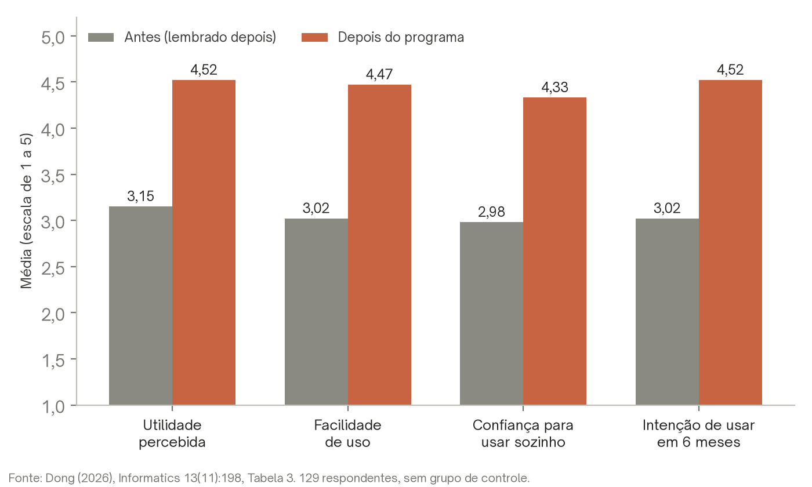
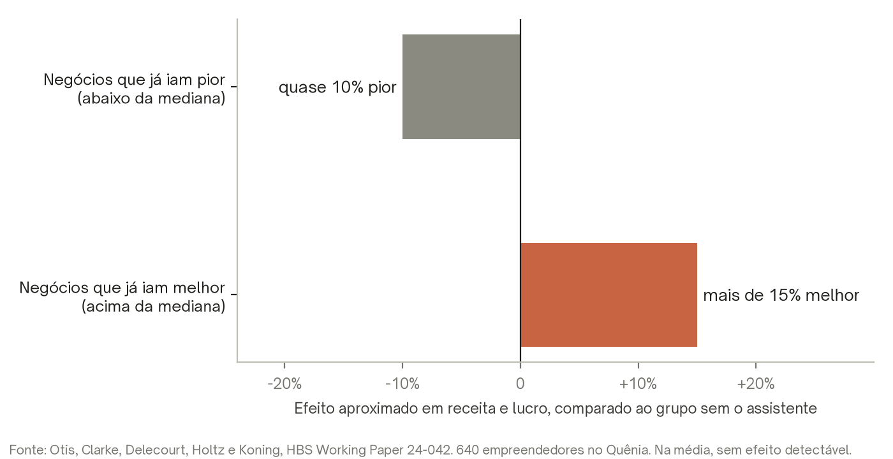
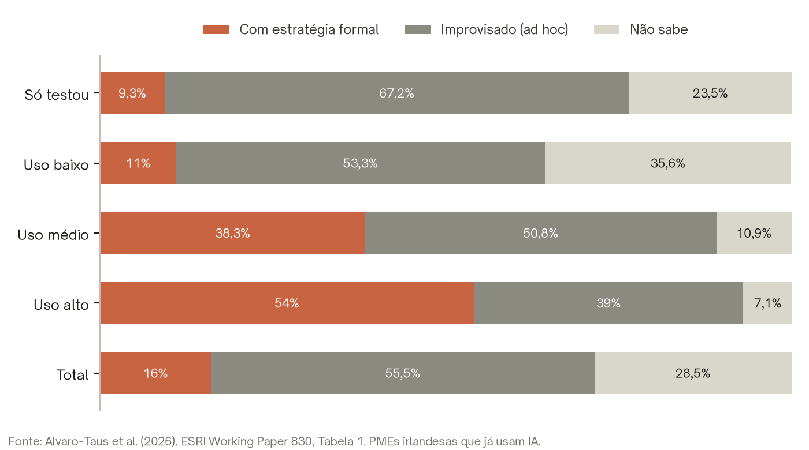
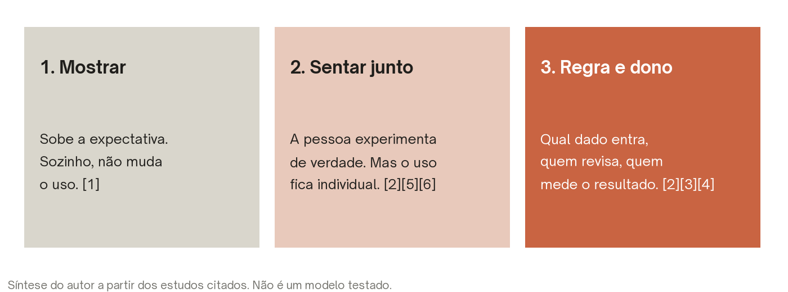

Compilado autoral. Não é tradução de um paper só. É a minha leitura de cinco estudos, com as referências numeradas no fim. Cada número tem a ressalva de onde veio.

## Por que este texto

Na segunda, 23/11, a OpenAI lançou nos Estados Unidos um programa chamado OpenWorks. Ela vai pagar até US$ 8 mil por mês a especialistas locais para sentar ao lado de donos de pequenas empresas, de graça para o dono, num projeto que ele mesmo escolhe [[6]](#ref-6).

Isso me chamou atenção por um motivo simples. A empresa que mais tem interesse em vender IA para o mundo está dizendo, com dinheiro, que a ferramenta sozinha não resolve. Precisa de gente do lado.

Fui atrás do que a pesquisa diz sobre isso. Li cinco estudos recentes sobre IA em empresa pequena. Eles não falam a mesma coisa em tudo. Mas, juntos, desenham um caminho que eu acho útil para o dono de PME daqui. Vou contar o que cada um mostra, onde eles se contradizem e o que eu tiro disso.

Sincero contigo: nenhum desses estudos é sobre empresa brasileira de R$ 5 a 100 milhões. São micronegócios no Chile, pequenas empresas nos EUA e na Irlanda, empreendedores no Quênia. A lógica ajuda. O número não se transfere direto.

## O dono já está convencido. E daí?

O estudo que mais me fez pensar é um experimento no Chile, de Marcos Balmaceda (KU Leuven) e Juan Pedro Ronconi (Universidad de los Andes) [[1]](#ref-1).

Eles pegaram 710 donos de micronegócios e sortearam quem ia ver uma demonstração: uma empreendedora fictícia usando o ChatGPT no próprio negócio. O outro grupo não via nada de útil. Depois mediram três coisas: quanto o dono esperava ganhar com IA, quanto ele toparia pagar por uma mentoria de IA na mesma hora, e o que ele fez depois. Isso inclui entrar num curso gratuito sete semanas depois e o uso declarado de IA quatro meses e meio depois.

O resultado é desconfortável para quem vive de palestra. A demonstração funcionou para mudar a cabeça: entre quem não esperava ganho nenhum, a expectativa subiu cerca de meio desvio padrão. Mas o comportamento não mudou. Não subiu a disposição de pagar, não subiu a inscrição no curso, não subiu o uso meses depois.

Quando perguntaram o que segura o uso regular, os donos falaram de dinheiro, de privacidade dos dados e de tempo. Não falaram que não viam utilidade.

O que eu tiro disso: o dono de PME, em geral, não precisa de mais um vídeo mostrando que a IA é incrível. Ele já desconfia que serve para alguma coisa. O que trava é outra coisa. Falta tempo, falta alguém para fazer junto e falta segurança sobre o que pode e o que não pode entrar na ferramenta.

Ressalva: é um documento de trabalho, sem revisão por pares. Li o resumo oficial e o resumo da página do autor. O PDF completo do SSRN estava bloqueado para download. A página do autor cita 736 participantes, e o resumo do SSRN cita 710, o que sugere versões diferentes do texto. A intervenção foi curta e online, e parte do uso foi autodeclarada. Um resultado nulo mostra que essa intervenção não moveu o uso. Não prova que nada funciona.

## Sentar junto muda o uso. Mas cria outro problema

O segundo estudo vai na direção que a OpenAI apostou. Xue A. Dong, da Colorado State University, avaliou um programa de extensão universitária que fez 20 oficinas e consultorias técnicas para 236 donos de pequenas empresas, entre 2025 e 2026 [[2]](#ref-2).

Não era palestra. Tinha exercício supervisionado, guia de prompts e consultoria individual depois.

Dos 129 que responderam à pesquisa depois do programa, a percepção mudou bastante. A nota média de utilidade foi de 3,15 para 4,52, numa escala de 1 a 5. A confiança para usar sozinho foi de 2,98 para 4,33. E 90% disseram ter experimentado pelo menos uma tarefa com IA nas semanas ou meses depois da oficina.

<figure class="fig">

<figcaption><b>Figura 1: o que mudou na percepção dos donos depois do programa.</b> Médias em escala de 1 a 5. O "antes" foi lembrado pelos próprios participantes depois do programa, sem grupo de controle. Fonte: Dong (2026), Tabela 3 [2].</figcaption>
</figure>

Até aqui, parece só boa notícia. O achado que me interessou mais está nas entrevistas com 21 donos.

Nenhum deles descreveu ter uma política de uso de IA na empresa. Nenhum tinha uma pessoa responsável pelas decisões sobre IA. Nenhum tinha orientação sobre quais dados do negócio podiam entrar na ferramenta. Cinco disseram com todas as letras que isso não existia. Um dos entrevistados, que assessora outras organizações, contou de equipes colocando informação confidencial de cliente na IA.

A autora chama isso de lacuna de governança. A pessoa aprende e começa a usar. A empresa, como organização, continua sem regra nenhuma. O uso fica individual, solto, e o risco também.

Para mim, esse é o ponto central do compilado. Sentar junto resolve a primeira trava. Mas, se ninguém define regra e dono, a empresa troca um problema por outro.

Ressalva: amostra autosselecionada, de quem quis fazer a oficina, no Colorado rural. Sem grupo de controle. O "antes" foi respondido depois, de memória. A própria autora diz que os 90% são um teto para gente motivada, não uma estimativa da população. E o roteiro de entrevista não perguntava diretamente sobre governança. Então o silêncio de 16 entrevistados não prova que eles não tinham regra.

## Conselho de IA sem critério pode piorar o negócio

O terceiro estudo é o mais antigo da lista e, para mim, o mais importante para quem acha que é só "liberar o ChatGPT" [[3]](#ref-3).

Pesquisadores de Berkeley, Harvard e Columbia sortearam 640 empreendedores no Quênia. Metade ganhou um assistente de negócios com GPT-4 pelo WhatsApp. A outra metade não.

Na média, não deu para detectar efeito nenhum em receita e lucro. Mas a média escondia duas histórias opostas. Quem já ia melhor antes do teste se beneficiou: os autores estimam mais de 15% de ganho. Quem já ia pior piorou: quase 10% de queda.

<figure class="fig">

<figcaption><b>Figura 2: o mesmo assistente, efeitos opostos.</b> Estimativas aproximadas dos autores, comparadas ao grupo sem o assistente. Na média geral, o efeito não foi estatisticamente diferente de zero. Fonte: Otis et al. [3].</figcaption>
</figure>

O detalhe que importa: os dois grupos fizeram perguntas parecidas e receberam conselhos parecidos. A diferença estava em qual conselho cada um escolheu aplicar. Os negócios mais fracos tenderam a aplicar a receita genérica, como baixar preço e gastar com propaganda. Os mais fortes usaram a IA para achar soluções específicas para o próprio caso.

Traduzindo para a PME: a IA não substitui o critério de quem conhece o negócio. Ela amplifica. Se o critério é bom, ajuda. Se não tem critério, ela dá uma resposta convincente para a decisão errada.

Por isso, quando eu falo em regra e dono, não é burocracia. É ter alguém que sabe dizer "isso não serve para a gente" antes de aplicar.

Ressalva: o experimento foi feito com empreendedores no Quênia, a maioria com ensino superior, em negócios bem menores que a PME típica daqui. O estudo saiu em 2023 e foi revisado depois. Os percentuais por grupo vêm de análises de subamostra e têm margem larga.

## Quanto mais a empresa usa, mais ela formaliza

O quarto estudo é uma pesquisa com 1.503 pequenas e médias empresas na Irlanda, feita pelo instituto ESRI com o Ministério das Finanças irlandês [[4]](#ref-4).

Os números de adoção são modestos: 16,5% das PMEs da amostra usavam alguma IA no início de 2025. Entre as médias empresas, 22,3%. E 23,4% planejavam investir nos três anos seguintes.

O dado que eu mais gosto é outro. Entre as empresas que já usam IA, a maioria usa de forma improvisada: 55,5%. Só 16% têm uma estratégia formal. Mas, olhando por intensidade, o quadro muda. Entre quem só testou, 9,3% têm estratégia formal. Entre quem usa muito, 54%.

<figure class="fig">

<figcaption><b>Figura 3: quem usa mais, organiza mais.</b> Percentual de PMEs irlandesas que usam IA, por nível de uso, segundo a forma de adoção. Fonte: Alvaro-Taus et al. (2026), Tabela 1 [4].</figcaption>
</figure>

As empresas de uso alto também são as que mais dizem que a IA superou a expectativa: 93%. Entre as que só testaram, a resposta mais comum foi "resultado misto".

Aqui eu preciso ser cuidadoso. Isso é correlação. Pode ser que formalizar ajude a usar mais. Pode ser que quem já usa muito acabe formalizando. Pode ser que empresas mais organizadas façam as duas coisas. O estudo não separa isso.

Também tem uma tensão com o estudo do Chile. Os autores irlandeses concluem que a falta de conhecimento sobre o benefício é a barreira que mais explica quem não adota, e sugerem campanhas de conscientização. O experimento chileno testou exatamente isso, com sorteio, e não viu mudança de comportamento. Os dois podem estar certos ao mesmo tempo: quem não conhece não adota, mas conhecer não basta para adotar.

Ressalva: documento de trabalho, sem revisão por pares. Dados de janeiro de 2025, antes de muita ferramenta nova. Satisfação e uso são autodeclarados. A Irlanda tem estrutura de empresas bem diferente da brasileira.

## O que os donos escrevem quando ninguém está ensinando

O quinto estudo é do Federal Reserve de São Francisco [[5]](#ref-5). Na pesquisa nacional de crédito para pequenas empresas de 2024, nos EUA, eles fizeram uma pergunta aberta: "sua empresa usa ou pretende usar IA? Para quê?". Mais de 8.500 empresas responderam por escrito.

Cerca de 40% disseram usar ou planejar usar. Pouco mais da metade disse que não.

O que vale a leitura são as respostas. Tem dono entusiasmado. Tem dono que usa mas diz que "não é nada demais", e logo depois lista três usos. Tem dono que só usa porque a IA veio embutida no sistema que já pagava. E tem dono contra, em caixa alta.

Entre os que querem usar e não usam, as travas são as mesmas do Chile: custo, tempo, regulação do setor e não saber por onde começar. Uma resposta resume bem: "Eu não sei como, e não tem ninguém para me ensinar."

Entre os que decidiram não usar, aparecem motivos sérios, que eu respeito: medo de errar numa peça que precisa sair perfeita, cuidado com dado de cliente e propriedade intelectual, e a convicção de que o cliente quer gente. Uma usinagem de precisão escreveu que a IA ainda erra demais para confiar 100%.

Ressalva: análise qualitativa de uma pergunta aberta, respondida no fim de 2024. Os autores classificaram as respostas à mão. Não é estimativa precisa de adoção, e as citações representam a visão de quem escreveu.

## O que eu tiro disso tudo

Juntando os cinco, eu enxergo três degraus. Não é um modelo testado. É a minha síntese.

<figure class="fig">

<figcaption><b>Figura 4: três degraus para a IA sair do discurso.</b> Síntese do autor a partir dos estudos citados. Os números entre colchetes apontam as referências.</figcaption>
</figure>

**Primeiro degrau: mostrar.** Palestra, vídeo, caso de sucesso. Ajuda a abrir a cabeça. Pelo experimento do Chile, sozinho não muda o que a empresa faz [[1]](#ref-1).

**Segundo degrau: sentar junto.** Alguém que entende da ferramenta senta com quem faz o trabalho, num problema real, com o dado real. É aí que as pessoas de fato experimentam [[2]](#ref-2). É também o que a OpenAI está bancando agora [[6]](#ref-6) e o que os donos americanos pediram por escrito [[5]](#ref-5).

**Terceiro degrau: regra e dono.** Quem pode usar, com qual dado, quem revisa antes de sair para o cliente e quem mede o resultado. Sem isso, o uso fica individual e o risco também [[2]](#ref-2). E o critério de quem conhece o negócio continua sendo o filtro [[3]](#ref-3). As empresas que mais usam são as que mais formalizam [[4]](#ref-4).

A maioria das conversas sobre IA para PME para no primeiro degrau. Algumas chegam no segundo. Quase ninguém fala do terceiro. E, pelo que esses estudos mostram, é no terceiro que a coisa vira rotina da empresa, e não hobby de um funcionário.

Uma observação honesta. Eu trabalho justamente com o segundo e o terceiro degraus. Então leia esta conclusão sabendo disso. Os dados que eu trouxe estão nas referências, para você conferir sem depender da minha leitura.

## Como testar na segunda

Se eu fosse começar amanhã numa PME de 50 pessoas, faria assim. É um exemplo hipotético, para adaptar.

- **Escolha uma tarefa só.** Chata, repetitiva, feita por uma pessoa. Exemplo: conferir preço de fornecedor, montar resposta de orçamento, resumir pedido que chegou por e-mail.
- **Sente uma hora com essa pessoa e a IA.** Com o problema real dela. Sem dado pessoal de cliente, sem dado bancário. Se não tiver ninguém de dentro que saiba, chame alguém de fora só para essa hora.
- **Escreva três regras numa folha.** Qual ferramenta pode usar. Qual dado não entra nunca. Quem revisa antes de ir para o cliente ou para o sistema.
- **Dê um dono.** Uma pessoa que responde pelo uso de IA nessa tarefa e que diz quando parar.
- **Meça antes e depois.** Duas semanas de cada lado: tempo gasto, erros pegos na revisão, retrabalho.
- **Degrau de autonomia:** prepara com aprovação. A IA rascunha. A pessoa decide e grava.

Depois de quatro semanas, você vai ter um número seu. Ele vale mais do que qualquer número deste texto. Faz sentido?

## Referências

Mantidas no idioma original.

[1] Balmaceda, Marcos, and Juan Pedro Ronconi. 2026. "Profit Expectations and the Depth of Generative AI Use in Small Firms." SSRN Working Paper 7130158, revised November 17, 2026. Earlier version titled "Belief Updating and AI Adoption by Entrepreneurs." <a href="https://papers.ssrn.com/sol3/papers.cfm?abstract_id=7130158">https://papers.ssrn.com/sol3/papers.cfm?abstract_id=7130158</a>.

[2] Dong, Xue A. 2026. "The Governance Gap in Generative AI Adoption in Small and Medium-Sized Enterprises (SMEs): A TAM-TOE Study of University Extension Bridging Individual Acceptance and Organizational Readiness." Informatics 13 (11): 198. Published November 16, 2026. <a href="https://doi.org/10.3390/informatics13110198">https://doi.org/10.3390/informatics13110198</a>.

[3] Otis, Nicholas G., Rowan Clarke, Solène Delecourt, David Holtz, and Rembrand Koning. "The Uneven Impact of Generative AI on Entrepreneurial Performance: Evidence from a Field Experiment in Kenya." Harvard Business School Working Paper 24-042 (2023, revised). <a href="https://www.hbs.edu/ris/Publication%20Files/24-042_567db548-5b24-4182-b703-9d5ef1328043.pdf">https://www.hbs.edu/ris/Publication%20Files/24-042_567db548-5b24-4182-b703-9d5ef1328043.pdf</a>.

[4] Alvaro-Taus, Marta, Keith Fitzgerald, Janez Kren, Cynthia O'Regan, and Conor O'Toole. 2026. "Drivers of AI Adoption and Investment Intentions: Insights from Irish SMEs." ESRI Working Paper No. 830, April 2026. <a href="https://www.esri.ie/system/files/publications/WP830.pdf">https://www.esri.ie/system/files/publications/WP830.pdf</a>.

[5] Sanchez-Moyano, Rocio, Natalie Holmes, and Sarah Simms. 2026. "AI Adoption Among Small Businesses: Qualitative Insights from the Small Business Credit Survey." Federal Reserve Bank of San Francisco Community Development Research Brief 2026-01, July 2026. doi:10.24148/cdrb2026-01. <a href="https://www.frbsf.org/wp-content/uploads/ai-adoption-among-small-businesses-cdrb202601.pdf">https://www.frbsf.org/wp-content/uploads/ai-adoption-among-small-businesses-cdrb202601.pdf</a>.

[6] OpenAI. 2026. "OpenWorks." Program page, launched November 23, 2026. Company material, not a study. <a href="https://openai.com/openworks">https://openai.com/openworks</a>.

