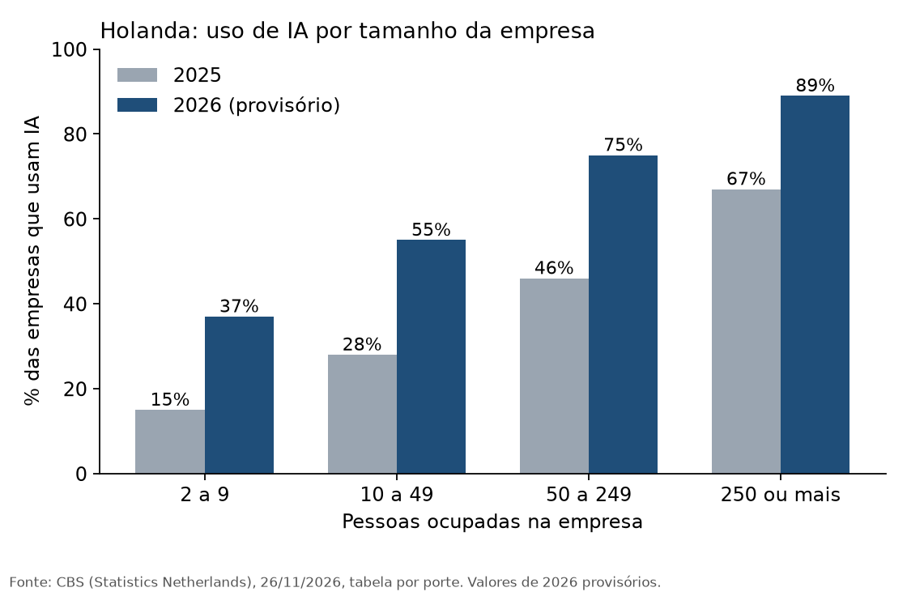
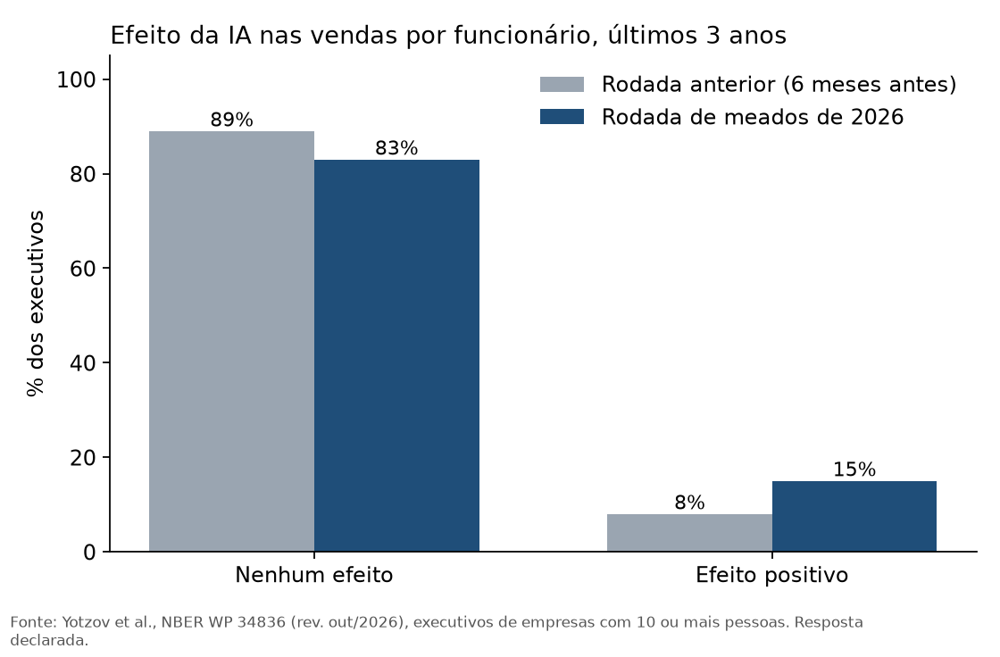
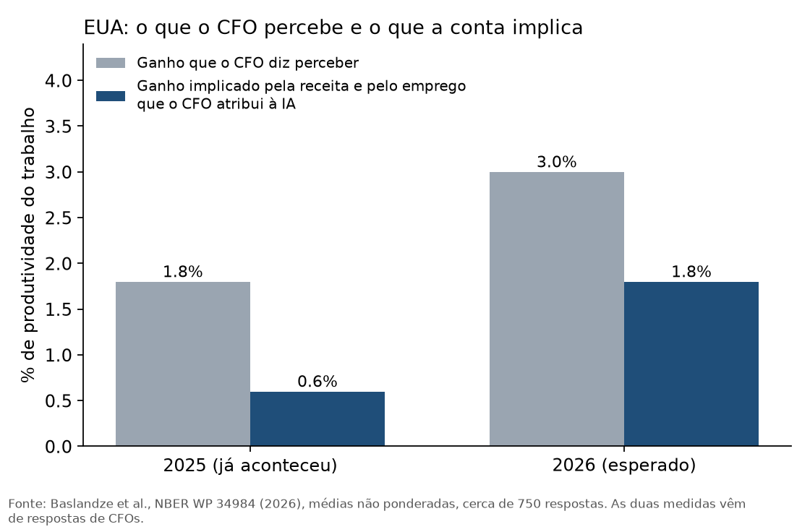
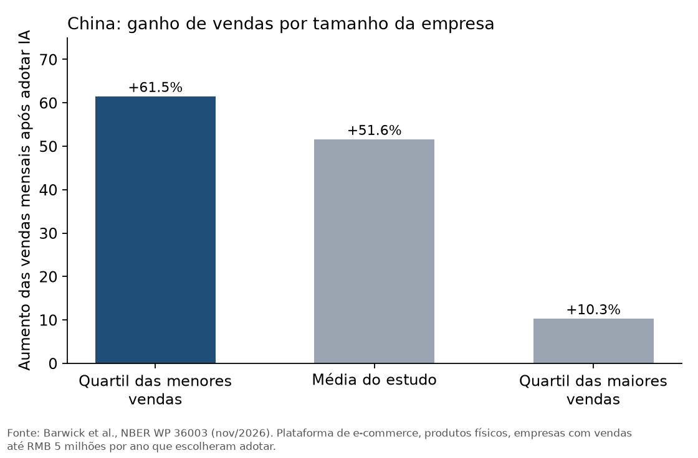

Compilado autoral. Não é tradução de um paper só. É a minha leitura de seis fontes, com as referências numeradas no fim. Três são working papers do NBER, duas são estatísticas oficiais e uma é relatório de fornecedor. Cada número tem a ressalva de onde veio.

Imagina uma distribuidora com 120 funcionários. *(Cena hipotética, inventada para ilustrar.)* No fim do trimestre, o contador pergunta ao dono: "A IA se pagou?". O dono pensa em como o time elogia a ferramenta e responde: "Acho que sim, o pessoal está mais rápido". O contador pergunta mais rápido em quê, quanto, e comparado a quê. O dono fica um tempo sem resposta.

Eu não sei se essa cena é comum. Mas o "acho que sim" do dono é, no fundo, o que várias pesquisas desta semana medem. Vale olhar com calma.

## Por que este texto

Hoje, 26/11, o instituto oficial de estatística da Holanda, o CBS, publicou os números de uso de IA nas empresas. Entre as empresas holandesas com 50 a 249 pessoas, 75% usam alguma tecnologia de IA. Um ano antes eram 46% [[1]](#ref-1). Na faixa de 10 a 49 pessoas, o salto foi de 28% para 55% [[1]](#ref-1). No mesmo dia, o escritório de estatística da Nova Zelândia divulgou que 52% das empresas que responderam à pesquisa de operações de 2026 usam IA [[2]](#ref-2).

O que me chamou atenção foi outra linha da tabela holandesa. Entre as empresas que usam, 54% dizem que a IA aumentou a produtividade. E uma em cada quatro diz que não teve efeito nenhum [[1]](#ref-1).

Fui atrás de quem tentou medir isso de outro jeito. Sincero contigo: nenhuma dessas fontes é sobre empresa brasileira. Duas são de países pequenos, uma é dos Estados Unidos, uma é da China, uma mistura vários países e uma é de fornecedor. A lógica ajuda. O número não se transfere direto para uma empresa de R$ 5 a 100 milhões daqui.

## O número que mais sobe é o de uso

Vamos começar pelo que é fácil de ver. O uso de IA subiu muito, em todos os tamanhos.

<figure class="fig">

<figcaption><b>Figura 1: o uso dobrou na Holanda, e a faixa de 50 a 249 pessoas já está em 75%.</b> Percentual das empresas que usam ao menos uma tecnologia de IA. Valores de 2026 provisórios. Fonte: CBS, 26/11/2026, tabela por porte [1].</figcaption>
</figure>

Dois detalhes da mesma publicação. O uso de IA para gerar texto passou de 8% para 28% das empresas. E o uso em contabilidade e finanças subiu de 17% para 30% entre as empresas que usam IA [[1]](#ref-1). Por setor, transporte e armazenagem foi de 7% para 28%, e comércio varejista e atacadista de 14% para 38% [[1]](#ref-1). Ou seja, setores que a gente atende por aqui também aparecem na curva, só que mais atrás.

Agora a ressalva que eu não posso pular. O número de uso depende de quem pergunta e de como pergunta. Um grupo de economistas de oito bancos centrais lembra, numa nota de rodapé, que pesquisas do censo americano acharam entre 5% e 9% das empresas usando IA em 2024, enquanto uma pesquisa online da McKinsey achou 88% das organizações usando IA em ao menos uma função em 2025. Os autores apontam uma diferença de dez vezes entre fontes e dizem não ficar claro se a amostra da McKinsey é representativa [[3]](#ref-3).

O relatório da Intuit mostra isso dentro de uma mesma casa. Na pesquisa com mais de 34 mil pequenas e médias empresas, 77% das americanas dizem usar IA regularmente em janeiro de 2026. Já nos registros de pagamento (4,3 milhões de empresas americanas), 12% pagaram ao menos uma vez, entre 2021 e 2025, por uma assinatura avulsa de IA de terceiros [[6]](#ref-6). Os dois números podem estar certos. Eles medem coisas diferentes: usar de vez em quando, inclusive de graça, e pagar.

Minha leitura: uso alto é um fato. Mas "usa IA" é uma pergunta fraca. Ela não diz se a empresa ganhou alguma coisa.

## Dizer que ajudou não é o mesmo que medir

Aqui as fontes começam a se separar.

Na Holanda, 54% de quem usa diz que ganhou produtividade [[1]](#ref-1). Na Nova Zelândia, perto de 60% dos que usam dizem que a produtividade do trabalhador subiu, e 68% relatam benefícios operacionais, como achar informação mais rápido para decidir [[2]](#ref-2). No relatório da Intuit, cerca de três em cada quatro empresas que usam dizem que a IA as deixou mais produtivas [[6]](#ref-6).

Esses são números de gente que usa e gosta. Agora olha o que acontece quando a pergunta é mais específica.

O grupo dos bancos centrais, com Nicholas Bloom, de Stanford, e coautores, perguntou a executivos como a IA mexeu nas vendas por funcionário nos últimos três anos. Foram quase 9 mil CFOs, CEOs e executivos seniores nos Estados Unidos, Reino Unido, Alemanha, Austrália, Canadá, México e África do Sul. Pelos slides da apresentação, a pergunta teve 8.438 respostas, e a empresa típica da amostra tem cerca de 250 funcionários [[3]](#ref-3) [[7]](#ref-7). Resultado: 83% disseram que não houve efeito. Eram 89% na rodada de seis meses antes. Disseram efeito positivo 15%, contra 8% antes [[3]](#ref-3).

<figure class="fig">

<figcaption><b>Figura 2: quando a pergunta é venda por funcionário, 83% dizem que não mudou nada.</b> Duas rodadas da pesquisa. Resposta declarada por executivos de empresas com 10 ou mais pessoas. Fonte: Yotzov et al., NBER WP 34836 [3].</figcaption>
</figure>

O efeito médio que eles estimam é de 0,5% acumulado em três anos, algo como 0,2% ao ano. Para os próximos três anos, esperam 0,6% ao ano [[3]](#ref-3). Por que não é fácil comparar com a Holanda? Porque são países diferentes, a pergunta é outra (vendas por funcionário, e não "produtividade") e a base é outra (todas as empresas, e não só as que usam). Então não dá para dizer que 54% é errado e 15% é certo. Dá para dizer que a resposta muda muito com a pergunta.

Um segundo estudo mexe exatamente nessa diferença. Salomé Baslandze e colegas, do Fed de Atlanta, da Duke e de outras instituições, perguntaram a 748 executivos financeiros americanos, no fim de 2025 e começo de 2026, duas coisas [[4]](#ref-4). Primeiro, quanto a produtividade subiu por causa da IA. Segundo, quanto a receita e o emprego mudaram por causa da IA. Com a segunda resposta, eles calculam o ganho de produtividade que a conta implica. A empresa mediana da amostra tem 118 funcionários e US$ 46 milhões de receita [[4]](#ref-4).

<figure class="fig">

<figcaption><b>Figura 3: o CFO percebe mais ganho do que a própria conta de receita e emprego dele sustenta.</b> Médias não ponderadas, cerca de 750 respostas. As duas medidas vêm de respostas dos CFOs, e a segunda é calculada pelos autores. Fonte: Baslandze et al., NBER WP 34984, seção 4.1 [4].</figcaption>
</figure>

Em 2025, o ganho percebido foi de 1,8%, e o implicado, de 0,6%. Para 2026, os CFOs esperam 3,0% percebido e 1,8% implicado [[4]](#ref-4). Os autores chamam isso de paradoxo da produtividade: o ganho é visto antes de aparecer na receita, talvez porque a qualidade e o fluxo de trabalho melhoram primeiro e as vendas vêm depois [[4]](#ref-4). Eles notam que o ganho percebido de 2025 é parecido com o implicado de 2026. É uma possível explicação, e eles dizem que vem da expectativa dos próprios CFOs [[4]](#ref-4).

Repara no cuidado necessário. Também a medida "implicada" vem de resposta de CFO sobre receita e emprego atribuídos à IA. Não é balanço auditado. Os autores listam o risco de otimismo e de pergunta mal entendida como limitação do método [[4]](#ref-4).

## O único estudo que mediu venda de verdade

O terceiro estudo muda de método, e por isso eu dou mais peso a ele, com uma ressalva grande. Panle Jia Barwick, da Universidade de Wisconsin, e coautores usaram os registros completos de uma grande plataforma chinesa de e-commerce [[5]](#ref-5). Em 2024, a plataforma colocou IA generativa dentro do programa de gestão que as lojas já usam, com duas funções: gerar conteúdo de anúncio (imagens, títulos, vídeos) e orientar a operação da loja.

Eles compararam 148.770 lojas que adotaram com 77.347 lojas parecidas que não adotaram, mês a mês, olhando as vendas reais. Ficaram só com lojas pequenas, de produtos físicos, com vendas de até 5 milhões de yuans por ano [[5]](#ref-5). Resultado: as vendas mensais subiram 51,6% e o número de pedidos subiu 47,0%, com pouca mudança no preço médio do pedido. O tempo de atendente por pedido caiu 5,6% [[5]](#ref-5).

O dado que mais me fez pensar é o de tamanho. O ganho foi de 61,5% no quarto das lojas com menores vendas e de 10,3% no quarto das maiores [[5]](#ref-5). E os autores dão um motivo concreto. Antes da IA, uma loja pequena podia comprar de agências o mesmo conteúdo. Só que, a preço de mercado, isso custaria 22,7% das vendas anuais da loja mediana do menor quarto, contra 0,4% no quarto maior [[5]](#ref-5). A IA virou um serviço que antes estava fora do alcance dela.

<figure class="fig">

<figcaption><b>Figura 4: o ganho foi proporcionalmente maior onde o serviço antes era caro demais.</b> Aumento das vendas mensais depois de adotar IA, por tamanho. Plataforma de e-commerce, produtos físicos, empresas que escolheram adotar. Fonte: Barwick et al., NBER WP 36003 [5].</figcaption>
</figure>

Agora o que esse estudo não prova. Ele não é sobre empresa brasileira, nem sobre indústria, serviço B2B ou distribuição. Só 11,3% das lojas da plataforma entraram na amostra principal, porque foram exigidas vendas todos os meses, produtos físicos e porte pequeno [[5]](#ref-5). As lojas escolheram adotar, e os autores dizem que o pareamento e o método de variável instrumental reduzem esse problema, mas não o eliminam [[5]](#ref-5). É um working paper, sem revisão por pares. E a lição de fundo não é "use IA". É que a IA veio dentro do sistema que o lojista já usa, para uma tarefa repetida e cara, e alguém acompanhou as vendas.

## O que eu tiro disso

Primeiro, onde eu concordo com os papers. Uso e resultado são coisas separadas. Dá para usar muito e não ter provado nada. O estudo do Fed de Atlanta mostra a distância entre o ganho percebido e o que a conta implica. O dos bancos centrais mostra um efeito pequeno hoje e um maior esperado para amanhã. Nos dois, o otimismo vem na frente da conta.

Segundo, onde eu discordo, ou melhor, onde eu seria cuidadoso. Ler "83% disseram que não houve efeito" e concluir que a IA não funciona é um salto. A pergunta era vendas por funcionário. Muito do que a IA faz hoje no escritório é tempo, qualidade e menos retrabalho, que demora a virar venda, como os próprios autores do Fed explicam [[4]](#ref-4). O contrário também vale: ler "54% dizem que ganharam produtividade" e achar que está provado. Não está. É opinião de quem usa.

Terceiro, o que não está provado, e eu quero ser claro nisso:

- Que o ganho do estudo chinês se repete em empresa brasileira de 20 a 300 pessoas, em serviço, indústria ou distribuição.
- Que o ganho se mantém depois do primeiro ano. Os próprios autores deixam isso como pergunta em aberto [[5]](#ref-5).
- Que o número de uso, sozinho, ajuda o dono a decidir alguma coisa.

Quarto, o ponto que liga com o que eu acredito. IA é ferramenta com limites. O que decide o resultado é o limite de autonomia que o dono define, e o problema vem antes da tecnologia. Para medir, isso ajuda muito. Nos dois primeiros degraus, em que a IA sugere ou prepara e a pessoa aprova, dá para comparar o tempo e o erro da pessoa com e sem a ferramenta. Quando a IA executa e avisa, ou executa sozinha, a medida fica mais difícil e mais importante. Normalmente eu começaria pelo segundo degrau justamente por isso.

E uma observação de dono, não de pesquisador. O estudo chinês sugere que a pergunta útil nem é "qual IA eu compro". É "qual tarefa repetida e cara no meu negócio o sistema que eu já uso poderia fazer, e como eu vou saber?". Vale perguntar ao fornecedor do ERP ou do CRM o que de IA já vem no que a gente paga. Faz sentido?

## Como testar na segunda

Um exemplo hipotético, para ficar concreto. Na distribuidora da abertura, o dono escolhe uma única tarefa: montar a cotação para o cliente.

- **Tarefa:** a cotação que hoje a assistente comercial monta à mão a partir do pedido do cliente e da tabela de preços.
- **Quem faz:** a própria assistente comercial. O dono não delega a medição.
- **Ferramenta:** o assistente de IA que a empresa já paga, numa conta corporativa, sem dados pessoais desnecessários do cliente.
- **Antes (duas semanas, sem IA):** anotar o tempo de cada cotação e quantas vezes o vendedor ou o financeiro achou erro depois.
- **Depois (duas semanas, com IA):** a IA prepara a cotação, a assistente confere antes de enviar. Anotar o tempo, os erros achados e o tempo gasto conferindo.
- **A conta no fim:** horas poupadas vezes o custo da hora, menos o custo da ferramenta e o tempo de revisão. Se não deu para chegar a esse número, a conclusão é "ainda não sei", e isso é uma resposta honesta.
- **Degrau de autonomia:** o segundo, **prepara com aprovação**. A IA sugere, a pessoa decide.

Nada disso exige um sistema novo. Exige uma planilha com quatro colunas e disciplina para anotar antes de ligar a ferramenta.

## A pergunta que fica

Se amanhã o contador te perguntar "a IA se pagou?", qual número você consegue mostrar, e quem anotou ele antes de a ferramenta entrar?

<b>Nota do que ficou de fora.</b> Foram nove fontes levantadas, seis entraram, três foram descartadas. (a) Babina, He e Jiang, NBER WP 35684 (ago/2026): mede IA pela contratação de gente de IA em grandes empresas de capital aberto dos EUA e liga ganho a "capital organizacional". Longe demais da PME e a medida não é de uso. (b) NBER WP 34851 (adultos num experimento online, fora de empresas): o PDF respondeu 403 e não consegui ler, então ficou de fora. (c) CFIB, Canadá (24/11/2026): 54% das pequenas empresas se engajam com IA e 21% adotaram, mas só mede adoção, sem resultado. Não achei, entre as empresas dos casos de hoje, paper ou estudo próprio.

## Referências

Mantidas no idioma original.

[1] Statistics Netherlands (CBS). 2026. "Use of AI by business has more than doubled, largest increase seen in SMEs." News release 2026/48, November 26, 2026. Estatística oficial (dados de 2026 provisórios). <a href="https://www.cbs.nl/en-gb/news/2026/48/use-of-ai-by-business-has-more-than-doubled-largest-increase-seen-in-smes">https://www.cbs.nl/en-gb/news/2026/48/use-of-ai-by-business-has-more-than-doubled-largest-increase-seen-in-smes</a>.

[2] Stats NZ and Ministry of Business, Innovation and Employment (Ipsos survey). 2026. "New Zealand businesses report productivity gains from AI." Survey of Business Operations 2026, news release of November 26, 2026. Estatística oficial, resposta declarada. <a href="https://www.stats.govt.nz/news/new-zealand-businesses-report-productivity-gains-from-ai/">https://www.stats.govt.nz/news/new-zealand-businesses-report-productivity-gains-from-ai/</a>.

[3] Yotzov, Ivan, Jose Maria Barrero, Nicholas Bloom, Philip Bunn, Chanya Chawla, Steven J. Davis, Kevin M. Foster, Aaron Jalca, Brent H. Meyer, Paul Mizen, Michael A. Navarrete, Samil Oh, Katia Garcia Loredo, Monique Reid, Pawel Smietanka, Gregory Thwaites, and Ben Zhe Wang. 2026. "Firm Data on AI." NBER Working Paper 34836, February 2026, revised October 2026. Working paper, sem revisão por pares. <a href="https://www.nber.org/papers/w34836">https://www.nber.org/papers/w34836</a>.

[4] Baslandze, Salomé, Zachary Edwards, John Graham, Ty McClure, Brent H. Meyer, Michael Sparks, Sonya R. Waddell, and Daniel Weitz. 2026. "Artificial Intelligence, Productivity, and the Workforce: Evidence from Corporate Executives." NBER Working Paper 34984, March 2026 (Federal Reserve Bank of Atlanta, Duke University). Working paper, sem revisão por pares. <a href="https://www.nber.org/papers/w34984">https://www.nber.org/papers/w34984</a>.

[5] Barwick, Panle Jia, Lu Fang, Jinhan Liu, Huilan Xu, and Zhe Yuan. 2026. "AI as Shared Business Infrastructure: Firm Growth and the Distribution of Gains." NBER Working Paper 36003, November 2026. Working paper, sem revisão por pares. <a href="https://www.nber.org/papers/w36003">https://www.nber.org/papers/w36003</a>.

[6] Intuit QuickBooks. 2026. "2026 AI Impact Report: Mapping adoption, use, and impact across small to midsize businesses in the US, Canada, the UK, and Australia." Relatório de fornecedor, feito com economistas convidados; pesquisas encomendadas pela Intuit (julho de 2024 a janeiro de 2026) e registros de pagamento de clientes. <a href="https://digitalasset.intuit.com/render/content/dam/intuit/sbseg/en_us/Blog/Downloadable-assset/2026-ai-impact-report.pdf">https://digitalasset.intuit.com/render/content/dam/intuit/sbseg/en_us/Blog/Downloadable-assset/2026-ai-impact-report.pdf</a>.

[7] Yotzov, Barrero, Bloom et al. 2026. "Firm Data on AI." Slides apresentados no Cleveland Fed, November 17, 2026. Material de apresentação dos autores de [3]. <a href="https://www.clevelandfed.org/-/media/project/clevelandfedtenant/clevelandfedsite/events/conversations-on-central-banking/2026/cf_nickbloom.pdf">https://www.clevelandfed.org/-/media/project/clevelandfedtenant/clevelandfedsite/events/conversations-on-central-banking/2026/cf_nickbloom.pdf</a>.

