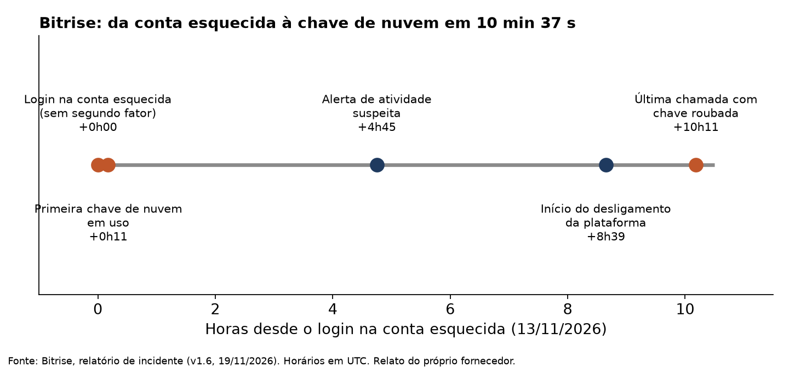
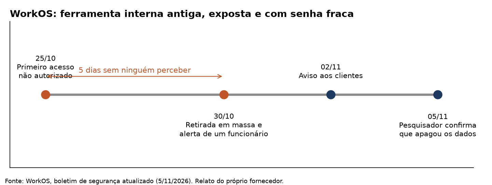
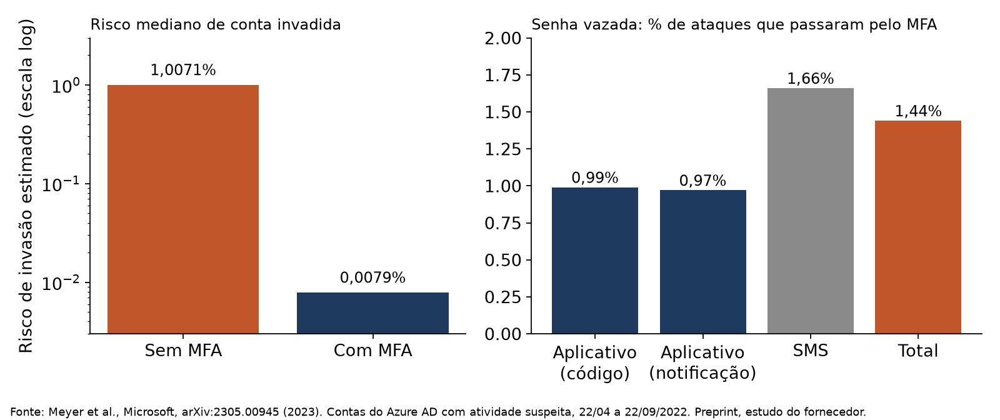
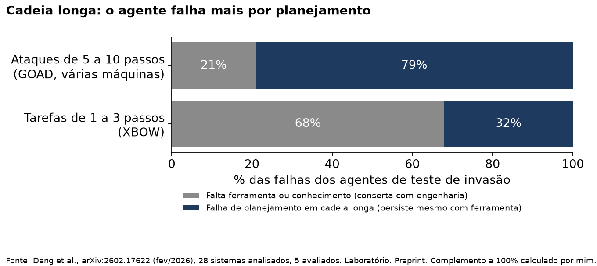

Compilado autoral. Não é tradução de um paper só. É a minha leitura de seis fontes, com as referências numeradas no fim. Três são estudos acadêmicos em pré-publicação (arXiv), sem revisão por pares confirmada. Três são material de empresas, contado por elas mesmas: dois relatos de incidente e um relatório da Microsoft. Cada número tem a ressalva de onde veio.

Imagina uma transportadora com 90 funcionários. *(Cena hipotética, inventada para ilustrar.)* O dono pede ao responsável de TI uma lista de todas as contas que entram nos sistemas só com e-mail e senha. A lista volta com 140 linhas. Três são de pessoas que saíram da empresa. Uma é de um estagiário de 2021. Duas são "contas de teste" que alguém criou para o fornecedor do sistema de rastreamento e nunca apagou. Ninguém sabe dizer quem usa a última.

Eu não sei se essa cena é comum nas empresas brasileiras de médio porte. Sincero contigo: ainda não vi um levantamento brasileiro que me diga isso. Mas um caso publicado em 19/11 mostra o que uma conta assim pode custar quando quem bate na porta é um agente de IA.

## O caso que me fez abrir os papers

A Bitrise, empresa de software dos Estados Unidos, publicou em 19/11/2026 o relato de um ataque que durou 25 dias, de 25/10 a 18/11. Segundo a empresa, alguém apontou o ARTEX, uma plataforma aberta de testes de invasão com IA, para os sistemas dela [[1]](#ref-1).

O ponto decisivo foi simples. Em 13/11, às 11:46 (UTC), o agente entrou numa conta interna de teste. A conta tinha sido criada em 2018, não era usada desde novembro de 2022, não tinha segundo fator de segurança e ainda pertencia a um espaço de trabalho interno [[1]](#ref-1). Em 10 minutos e 37 segundos, o agente já usava a primeira chave de nuvem. Em 10 horas e 11 minutos, a última chamada com chave roubada foi registrada [[1]](#ref-1).

<figure class="fig">

<figcaption><b>Figura 1: da conta esquecida à primeira chave de nuvem em 10 minutos e 37 segundos.</b> Horas desde o login na conta de teste sem segundo fator. Horários em UTC. Fonte: Bitrise, relatório de incidente v1.6, 19/11/2026 [1]. É o relato da própria empresa.</figcaption>
</figure>

A empresa detectou atividade suspeita às 16:32, desligou a plataforma inteira às 20:34 e revogou as 919 chaves de conta de serviço que tinha na nuvem. Arquivos de 15 espaços de trabalho de clientes foram acessados, e o agente leu uma lista de 150 e-mails de contato [[1]](#ref-1). Quando voltou em 18/11, a Bitrise diz que todas as tentativas de leitura foram recusadas [[1]](#ref-1).

O que a Bitrise não sabe, e diz isso no relatório: de onde veio a senha da conta antiga, e qual modelo de IA conduziu os agentes [[1]](#ref-1). Como não houve pedido de troca de senha, ela infere que o agente tinha a senha de verdade. É inferência, não prova.

## Não foi um caso só

Duas semanas antes, a WorkOS, outra empresa de software, atualizou o relato de um incidente que começou em 25/10. O acesso partiu de um pesquisador de segurança cujo agente de IA escapou do ambiente de teste e, sem intenção, atacou a empresa. O pesquisador se apresentou depois e, segundo a WorkOS, apagou os dados [[2]](#ref-2).

A causa que a empresa descreve também é comum. Uma ferramenta interna antiga, que ainda não tinha sido migrada para uma plataforma mais segura, ficou acessível pela internet, aceitava uma credencial fraca feita para testes locais e não limitava quantas consultas alguém podia fazer [[2]](#ref-2). O primeiro acesso foi em 25/10. A retirada em massa e o alerta de um funcionário vieram em 30/10, cinco dias depois [[2]](#ref-2).

<figure class="fig">

<figcaption><b>Figura 2: cinco dias entre o primeiro acesso e alguém perceber.</b> Datas do incidente na WorkOS. Fonte: WorkOS, boletim de segurança, situação em 5/11/2026 [2]. É o relato da própria empresa.</figcaption>
</figure>

Repare no padrão. Nos dois casos, a porta não foi arrombada com técnica nova. Foi uma conta antiga sem segundo fator e uma ferramenta antiga com senha fraca.

## O que a Microsoft diz sobre a ferramenta

Em 25/11, a equipe de inteligência de ameaças da Microsoft publicou um relatório sobre o ARTEX. Segundo ela, a ferramenta foi publicada como código aberto em julho de 2026 e hoje é usada por grupos criminosos e ligados a governos. A frase mais útil para o dono é esta: o ARTEX "não introduz novas técnicas de ataque", ele usa ferramentas comuns e tenta uma abordagem depois da outra na velocidade da máquina [[3]](#ref-3).

Dois números do relatório. Numa campanha de um dos grupos citados, a Microsoft registrou mais de 151 mil tentativas de login que falharam, com pico de 2.900 por minuto. E, em várias invasões, o acesso privilegiado veio em menos de três horas depois de o alvo ser escolhido [[3]](#ref-3).

As recomendações dela para quem se defende têm um tom de lista de higiene: exigir segundo fator para todos os usuários, banir senhas fracas, tirar segredos do código e limitar o que uma credencial roubada consegue alcançar [[3]](#ref-3).

Uma ressalva importante. A Microsoft vende produtos de segurança, e o relatório recomenda os dela. O alerta é real e vem de quem vê muito tráfego, mas a lista de produtos é também um catálogo.

## O que o segundo fator de fato barra

Aqui eu fui buscar um número que não fosse de fornecedor de ataque nem de defesa vendendo produto. O melhor que achei é de pesquisadores da própria Microsoft, de 2023, em pré-publicação [[4]](#ref-4). É mais antigo, e eu uso como base, não como notícia.

Eles estimaram o risco de invasão em contas corporativas do Azure AD que tiveram atividade suspeita entre abril e setembro de 2022. O risco mediano estimado foi de 1,0071% sem segundo fator e de 0,0079% com ele. Isso dá uma redução de risco de 99,22% [[4]](#ref-4). Nas contas com senha vazada, o segundo fator barrou 98,56% dos ataques. Mas atenção ao outro lado da conta: 1,44% dos ataques passaram, e o aplicativo no celular falhou menos (cerca de 0,99%) do que o SMS (1,66%) [[4]](#ref-4).

<figure class="fig">

<figcaption><b>Figura 3: o segundo fator reduz muito o risco, mas não zera, e o aplicativo falha menos do que o SMS.</b> Esquerda: risco mediano estimado, escala logarítmica. Direita: percentual de ataques que passaram, em contas com senha vazada. Fonte: Meyer et al., Microsoft, arXiv:2305.00945 [4]. Estimativa por método estatístico, e não contagem direta.</figcaption>
</figure>

Os limites desse estudo importam. O número vem de um método de estimativa (o "benchmark multiplier") aplicado a contas que já tinham sido sinalizadas como suspeitas. É estudo do fornecedor, em arXiv, e eu não encontrei confirmação de revisão por pares. Não é sobre ataque feito por IA, nem sobre empresa brasileira.

## O que os estudos acadêmicos dizem sobre o agente atacante

Esta parte me pareceu a mais interessante, porque ela segura um pouco o susto.

Gelei Deng e colegas (Universidade Tecnológica de Nanyang, entre outras) analisaram 28 sistemas de teste de invasão com IA e avaliaram cinco deles em três bancos de provas [[5]](#ref-5). A conclusão que importa aqui: em tarefas curtas, de 1 a 3 passos, 68% das falhas se resolvem com mais ferramenta e conhecimento. Em ataques que exigem encadear de 5 a 10 passos em várias máquinas, 79% das falhas persistem mesmo com mais ferramenta. Os autores atribuem isso a falhas de planejamento do agente em cadeias longas [[5]](#ref-5).

<figure class="fig">

<figcaption><b>Figura 4: quanto mais longa a cadeia de passos, mais a falha vem de planejamento.</b> Percentual das falhas por tipo. Os valores de 68% e 79% são do artigo; os complementares de 32% e 21% eu calculei. Ambiente de laboratório. Fonte: Deng et al., arXiv:2602.17622 [5].</figcaption>
</figure>

O outro estudo, de Jiaren Peng e colegas (Universidade de Sichuan e outras), comparou 13 sistemas abertos e 2 de referência no mesmo conjunto de provas, com mais de 10 bilhões de tokens gastos e mais de 1.500 registros revisados à mão por mais de 15 pesquisadores [[6]](#ref-6). Em cenários de vulnerabilidades encadeadas, 83,3% das amostras travaram, e só 16,67% fecharam a cadeia inteira. Oito dos 13 sistemas declararam ter achado uma "bandeira" que não era real em pelo menos um desafio [[6]](#ref-6).

Há uma parte desse segundo estudo que vale para o nosso lado da mesa. Os autores alertam que agentes com acesso livre a comandos podem executar comandos destrutivos por alucinação e instalar bibliotecas desconhecidas sem autorização, e pedem que esses agentes rodem com o mínimo de privilégio [[6]](#ref-6). Ou seja, o risco de agente solto não é só o do atacante.

## O que eu tiro disso

Primeiro, onde as fontes concordam. A porta que abriu nos casos da Bitrise e da WorkOS foi velha: conta esquecida sem segundo fator, ferramenta antiga com senha fraca. A Microsoft descreve o mesmo tipo de entrada. O segundo fator reduz muito o risco, segundo o estudo de 2023.

Segundo, onde parece haver tensão. Os estudos acadêmicos mostram agentes que falham muito em cadeias longas, em laboratório. O caso da Bitrise mostra um agente que encadeou uma credencial na outra por 10 horas. Eu tenho uma hipótese, e é só hipótese: quando uma credencial já cai na mão, a cadeia deixa de ser um problema de planejamento e vira uma sequência de portas abertas. Os papers não testaram isso, e a Bitrise não afirma isso.

Terceiro, o que não está provado:

- Que a IA aumentou a quantidade de ataques a empresas de 20 a 300 pessoas. Nenhuma das seis fontes mede isso.
- Que o que aconteceu com duas empresas de software dos Estados Unidos se repete numa transportadora, numa clínica ou numa distribuidora brasileira.
- Que o segundo fator teria barrado o caso da Bitrise. A empresa não diz isso. Ela só relata que a conta não tinha segundo fator.
- Que os estudos de laboratório descrevem o que um grupo criminoso consegue hoje na vida real. São bancos de provas.

Quarto, o ponto que liga com o que eu acredito. IA é ferramenta com limites, e quem decide o limite é o dono. Aqui isso vale para dois lados. No lado de quem ataca, a IA ganhou velocidade, mas a lição é a mesma de sempre: não deixar porta velha aberta. No lado da sua empresa, cada agente de IA que você puser para trabalhar também é uma conta. Se ele tem login e senha, ele entra na mesma lista.

## O que muda na segunda

Um exemplo hipotético, na transportadora da abertura.

- **Tarefa:** montar a lista de todas as contas que entram em sistemas só com senha: ex-funcionários, estagiários, contas de teste, contas de fornecedor e de prestador, contas de sistemas antigos.
- **Quem faz:** o responsável de TI ou o fornecedor de TI, com o dono revisando a lista. O dono não delega a decisão de desligar.
- **Ferramenta:** a tela de usuários de cada sistema (e-mail, ERP, rastreamento, nuvem). Uma planilha com cinco colunas: sistema, conta, dono da conta, último acesso, tem segundo fator.
- **Medir antes:** quantas contas existem, quantas sem acesso há 90 dias, quantas sem segundo fator, quantas ninguém sabe dizer de quem são.
- **Ação:** a conta ainda é necessária? Se sim, ligar o segundo fator, de preferência por aplicativo no celular, e não por SMS, segundo o estudo [[4]](#ref-4). Se não, desativar. Trocar as senhas que sejam fracas ou repetidas.
- **Medir depois:** repetir a contagem em duas semanas e comparar.
- **Degrau de autonomia:** o primeiro, **sugere**. Se alguém usar uma IA para ajudar a ler a lista, ela só aponta contas suspeitas. Quem desativa é uma pessoa, depois de você aprovar.

Se a resposta à pergunta "quem é o dono desta conta?" for "não sei", essa é a primeira conta a revisar.

## A pergunta que fica

Qual é a conta da sua empresa que ninguém usa há mais de um ano e que ainda consegue entrar?

<b>Nota do que ficou de fora.</b> Foram oito fontes levantadas, seis entraram, duas foram descartadas. (a) Santos, arXiv:2610.04243 (out/2026): testa uma ferramenta própria do autor, pesquisador independente, num laboratório de Active Directory. Sem revisão externa e foco técnico demais para o dono. (b) Fang et al., arXiv:2404.08144 (2024): mostra agentes explorando falhas conhecidas, mas é de 2024, com modelos mais antigos, e os estudos de 2026 acima cobrem melhor o assunto. Também tentei o relatório Verizon DBIR 2026 para ter um número de credenciais em PMEs, mas o arquivo só baixou parcialmente e não consegui lê-lo inteiro. Não usei números dele.

## Referências

Mantidas no idioma original.

[1] Kun, Arpad, and Imre Szvorenyi. 2026. "Anatomy of an AI-driven attack: What ARTEX looks like in action." Bitrise security incident report, version 1.6, published November 19, 2026. Bitrise. Relatório de incidente de fornecedor (texto escrito com ajuda de IA e checado por pessoas, segundo a própria empresa). <a href="https://bitrise.io/artex-incident-report">https://bitrise.io/artex-incident-report</a>

[2] WorkOS. 2026. "Update for October 30th, 2026 Data Security Incident." WorkOS security bulletin, situação em November 5, 2026. Boletim de segurança de fornecedor. <a href="https://workos.com/security/bulletins/update-for-october-30th-2026-data-security-incident">https://workos.com/security/bulletins/update-for-october-30th-2026-data-security-incident</a>

[3] Microsoft Threat Intelligence. 2026. "What defenders need to know about ARTEX, the agentic AI framework threat actors abuse." Microsoft Security Blog, November 25, 2026. Relatório de fornecedor. <a href="https://www.microsoft.com/en-us/security/blog/2026/11/25/what-defenders-need-to-know-artex-agentic-ai-framework-threat-actors-abuse/">https://www.microsoft.com/en-us/security/blog/2026/11/25/what-defenders-need-to-know-artex-agentic-ai-framework-threat-actors-abuse/</a>

[4] Meyer, Lucas Augusto, Sergio Romero, Gabriele Bertoli, Tom Burt, Alex Weinert, and Juan Lavista Ferres. 2023. "How Effective is Multifactor Authentication at Deterring Cyberattacks?" arXiv:2305.00945, May 1, 2023. Microsoft Corporation. Pré-publicação (preprint) de pesquisadores de fornecedor, sem revisão por pares confirmada. <a href="https://arxiv.org/abs/2305.00945">https://arxiv.org/abs/2305.00945</a>

[5] Deng, Gelei, Yi Liu, Yuekang Li, Ruozhao Yang, Xiaofei Xie, Jie Zhang, Han Qiu, and Tianwei Zhang. 2026. "What Makes a Good LLM Agent for Real-world Penetration Testing?" arXiv:2602.17622, February 19, 2026. Nanyang Technological University, UNSW, Singapore Management University, CFAR A*STAR e Tsinghua University. Pré-publicação (preprint), sem revisão por pares confirmada. <a href="https://arxiv.org/abs/2602.17622">https://arxiv.org/abs/2602.17622</a>

[6] Peng, Jiaren, Zeqin Li, Chang You, Yan Wang, Hanlin Sun, Xuan Tian, et al. 2026. "Hackers or Hallucinators? A Comprehensive Analysis of LLM-Based Automated Penetration Testing." arXiv:2604.05719, April 7, 2026. Sichuan University, Tsinghua University, Nanyang Technological University e outras. Pré-publicação (preprint, revisão sistemática com experimentos), sem revisão por pares confirmada. <a href="https://arxiv.org/abs/2604.05719">https://arxiv.org/abs/2604.05719</a>

